# Spielekiste

[](https://github.com/FionaPreroll/vibe-mugames/actions/workflows/ci.yml)
[](https://codecov.io/gh/FionaPreroll/vibe-mugames)
[](https://github.com/FionaPreroll/vibe-mugames/actions/workflows/android.yml)

Games for everyone at one table: board games, card and dice games, party games and games of skill, on phones side by side, in the browser and as an Android app, or together around one laptop or tablet. The phones connect directly to each other by QR code, over Wi-Fi or a hotspot one of them opens: no internet, no server, no accounts. The connection comes from [`@fionapreroll/p2p`](https://github.com/FionaPreroll/vibe-p2pgame/tree/main/packages/p2p), the library behind [Spark Hunt](https://github.com/FionaPreroll/vibe-p2pgame).

## Screenshots

<table>
  <tr>
    <td width="25%">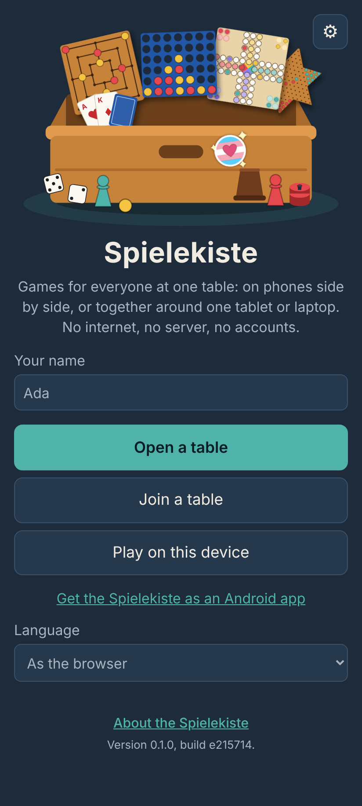</td>
    <td width="25%">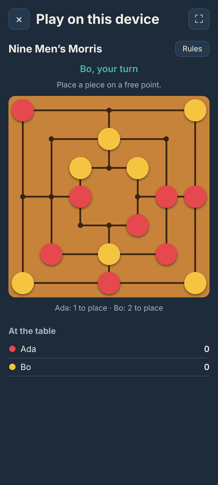</td>
    <td width="25%">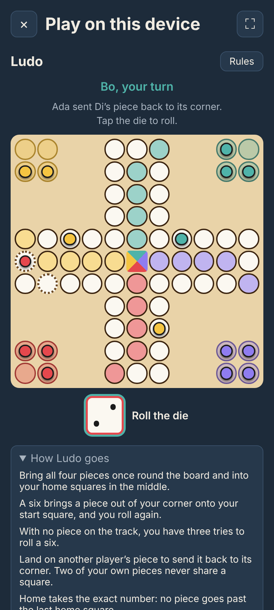</td>
    <td width="25%">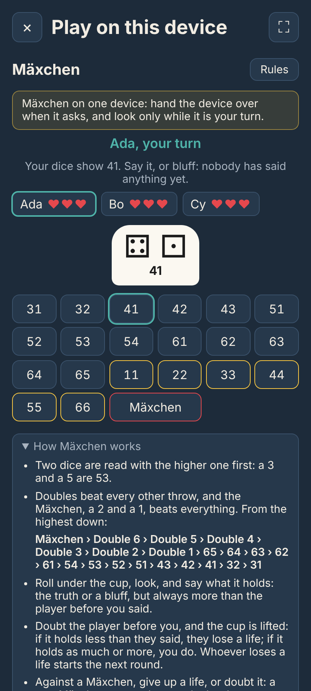</td>
  </tr>
  <tr>
    <td>The start screen</td>
    <td>Nine Men's Morris</td>
    <td>Ludo, for up to four</td>
    <td>Mäxchen: only the roller sees the dice</td>
  </tr>
  <tr>
    <td>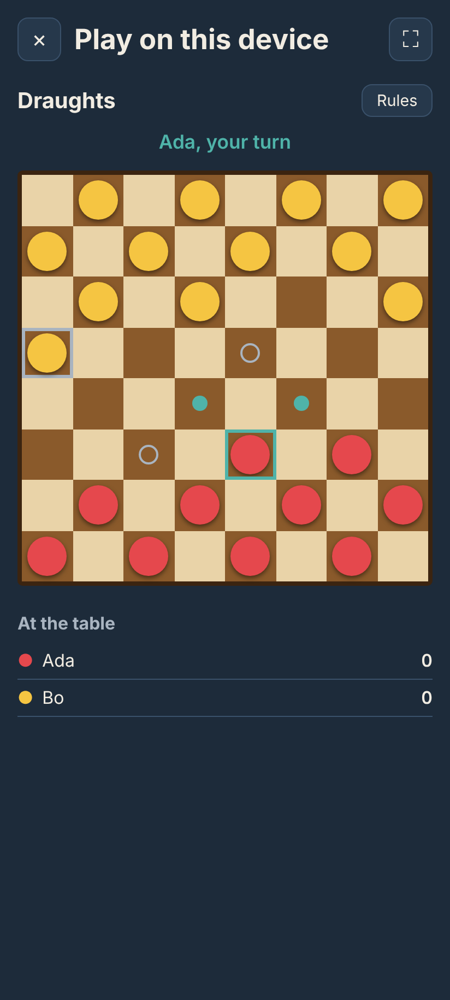</td>
    <td>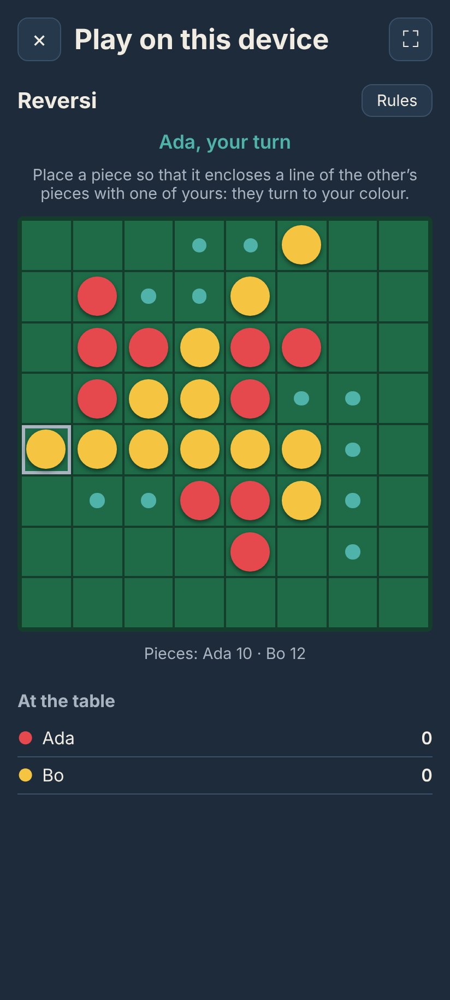</td>
    <td>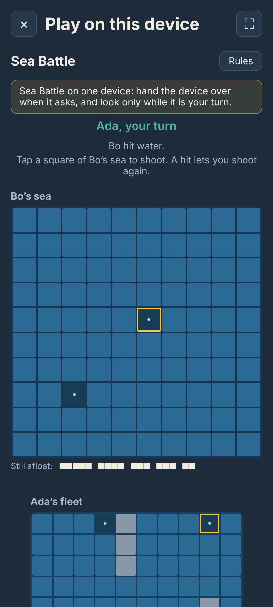</td>
    <td>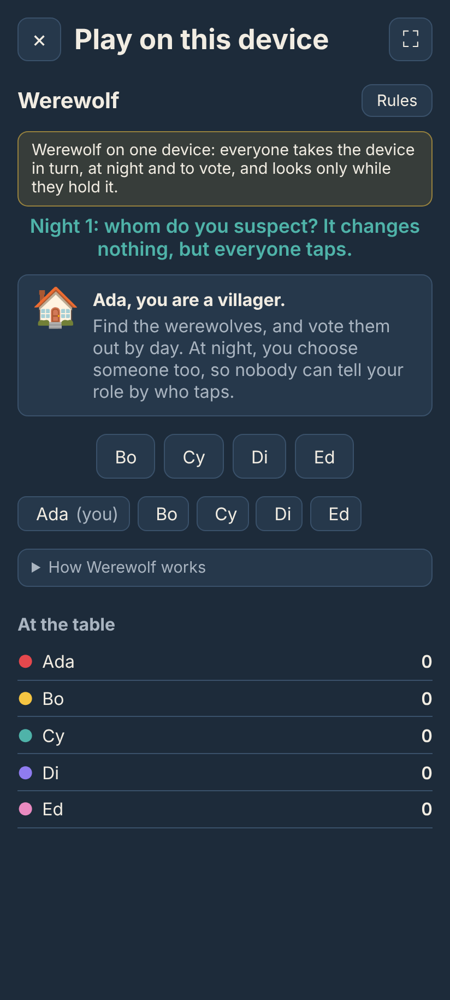</td>
  </tr>
  <tr>
    <td>Draughts</td>
    <td>Reversi</td>
    <td>Sea Battle, handed over between players</td>
    <td>Werewolf, handed round one device</td>
  </tr>
  <tr>
    <td>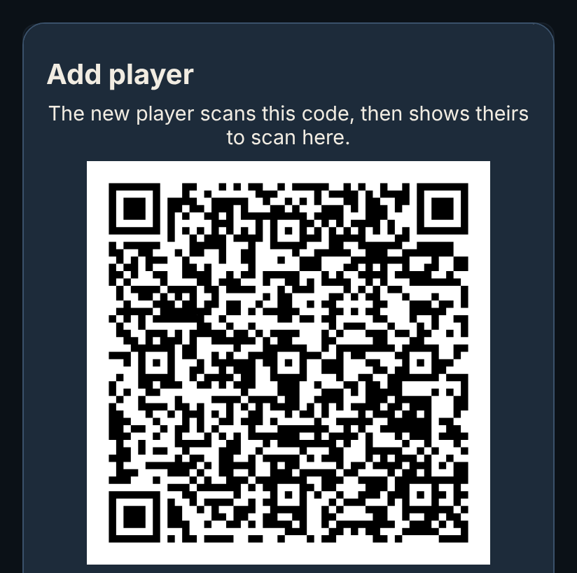</td>
    <td>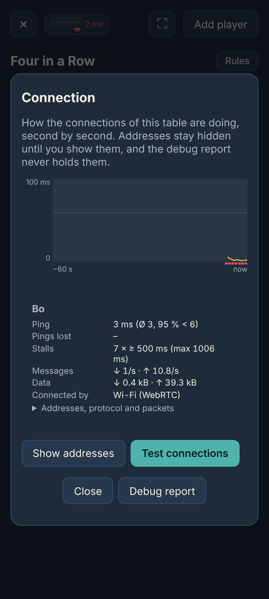</td>
    <td>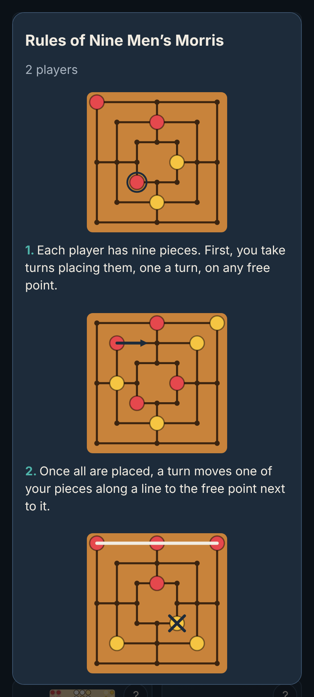</td>
    <td>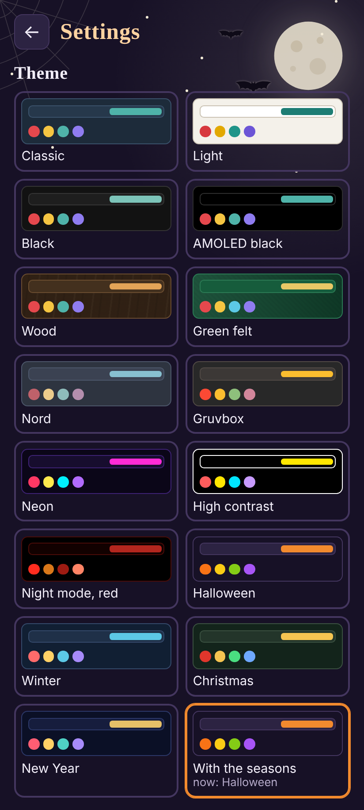</td>
  </tr>
  <tr>
    <td>Pairing by QR code</td>
    <td>Connection details</td>
    <td>The rules, with drawings</td>
    <td>Themes, here with the seasons: Halloween</td>
  </tr>
</table>

On a laptop or a tablet, the game chooser, and games on one device, taking turns or on a split screen:

<table>
  <tr>
    <td colspan="2">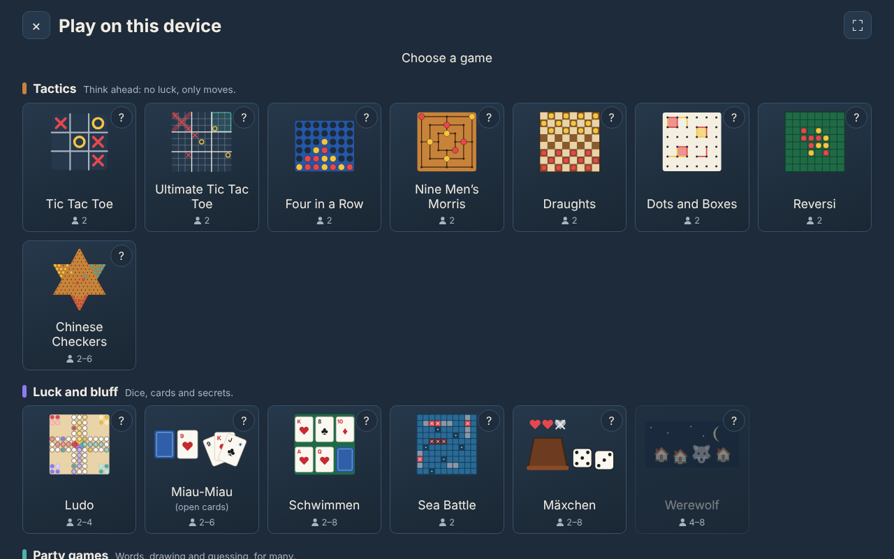</td>
  </tr>
  <tr>
    <td width="50%">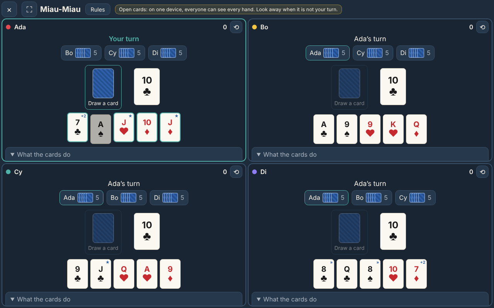</td>
    <td width="50%">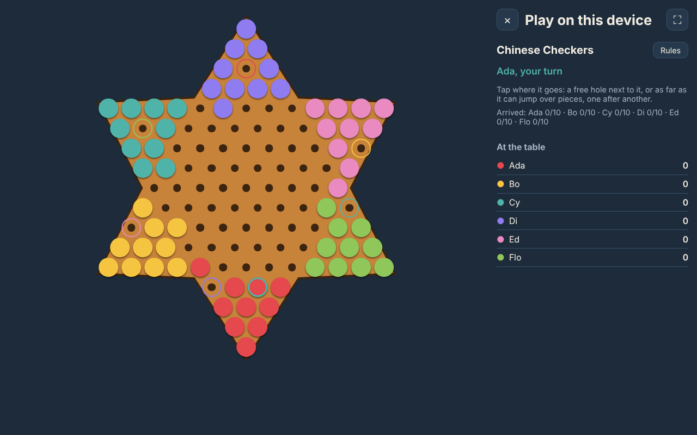</td>
  </tr>
  <tr>
    <td>Miau-Miau for four on a split screen</td>
    <td>Chinese Checkers for six</td>
  </tr>
</table>

The games in real time, between phones:

<table>
  <tr>
    <td width="37%">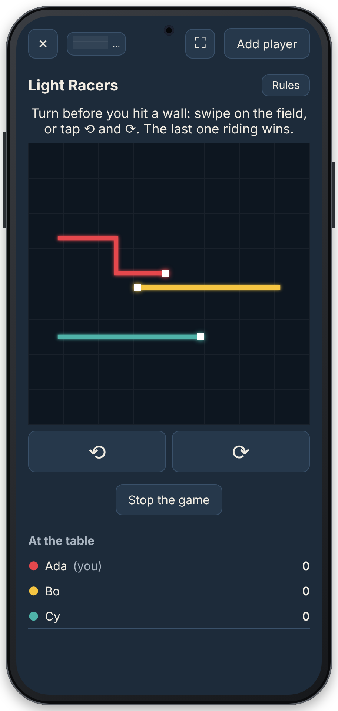</td>
    <td width="37%">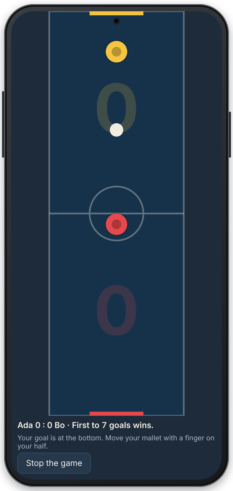</td>
    <td width="26%">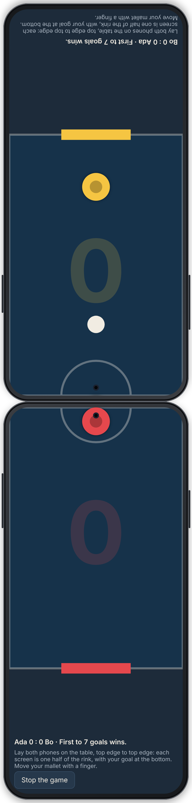</td>
  </tr>
  <tr>
    <td>Light Racers: each phone steers its own rider</td>
    <td>Air Hockey, the whole rink on each phone</td>
    <td>Air Hockey, or each phone its own half: laid top edge to top edge, the puck slides from one screen to the other</td>
  </tr>
</table>

The pictures are taken by `pnpm screenshots` and the _Screenshots_ workflow (see [Development](#development)).

## Playing

Play in the browser at **[fionapreroll.github.io/vibe-mugames](https://fionapreroll.github.io/vibe-mugames/)**, or in the Android app (below). One phone opens a table; everyone else sits down at it:

1. **Open a table** on the first phone, then **Add player**: it shows a QR code. In the app, both phones can connect by Bluetooth instead (below).
2. On the new player's phone, **Join a table** and scan that code. The phone then shows a code of its own, which the first phone scans. Without a camera, both codes can be copied and pasted as text. If the camera will not focus on the screen, tap the picture to focus, zoom out and hold the phone further away, switch cameras, or take a photo of the code instead. Sending a code over may take its time: the joining phone waits up to 10 minutes for the host to take its code. If a connection fails, both phones say so and offer **Try again**.
3. The host chooses a game. Up to eight phones sit at a table: two play the board games, Sea Battle and Air Hockey, up to four Ludo, up to six Miau-Miau, Light Racers and Chinese Checkers, up to eight Mäxchen and four to eight Werewolf, and the others watch and take turns. After a game, the winner stays and the others who played go to the back of the queue; when nobody waits, the next player in turn starts.

**By Bluetooth, in the app:** when joining a table or adding a player, the app asks how the phones connect: **QR code**, over the same Wi-Fi or a hotspot, or **Bluetooth**, without any Wi-Fi, if both phones have the app. With Bluetooth, the host's **Add player** makes the table visible to phones nearby; the player's phone lists the tables it finds, and the player taps the host's. Both phones show the same four-digit code: the host lets the player in only if it matches, and the dialog stays open for more players. One table can mix both ways. The first time, Android asks to allow nearby devices, and location, which it needs to find phones nearby over Bluetooth.

**On one device:** on a laptop or a tablet, **Play on this device** on the start screen seats two to six players at the device, with their names, and no network at all. They either take turns on one screen, which names whose turn it is and keeps the board the same way round for everyone, or, from two to four, split the screen into a part for each player, with their own view: their own cards, and in Draughts their own pieces at the bottom. A part turns round with **⟲**, for a player sitting across the table. Games with hidden cards, such as Miau-Miau, are played with open cards there: everyone can see every hand, and the lobby and the game say so. Sea Battle keeps its fleets hidden instead, Mäxchen the dice under the cup and Werewolf the roles: taking turns, the device asks to be handed over after each player's turn and shows nothing until the next player says they hold it; on a split screen, a player's own fleet, dice or role shows only while they ask to see it. In the games in real time, everyone steers at once: on one screen, each player has their own keys and buttons (W A S D, the arrow keys, I J K L and the number pad's 8 4 5 6), and in Air Hockey a finger on either half of the rink moves that half's mallet; on a split screen, each part has its own field, and Air Hockey shows each player the rink from their end, with their goal at the bottom (or only their half, as the settings say). The device remembers who played and how.

The games:

| Game                                  | Players |
| ------------------------------------- | ------- |
| Tic Tac Toe                           | 2       |
| Four in a Row (_Vier in einer Reihe_) | 2       |
| Nine Men's Morris (_Mühle_)           | 2       |
| Draughts (_Dame_)                     | 2       |
| Ludo (dice)                           | 2–4     |
| Miau-Miau (Mau-Mau, cards)            | 2–6     |
| Sea Battle (_Schiffe versenken_)      | 2       |
| Mäxchen (dice)                        | 2–8     |
| Werewolf (_Werwolf_)                  | 4–8     |
| Light Racers (_Lichtrenner_), live    | 2–6     |
| Air Hockey (_Airhockey_), live        | 2       |
| Dots and Boxes (_Käsekästchen_)       | 2       |
| Reversi                               | 2       |
| Chinese Checkers (_Sternhalma_)       | 2–6     |

**Nine Men's Morris:** each player places nine pieces, one a turn, then moves them along a line to a free neighbouring point; with only three left, they jump to any free point. Three in a row on a line make a mill, which takes one of the other player's pieces, one outside a mill if there is any. Fewer than three pieces, or none that can move, lose; fifty moves without a mill are a draw.

**Draughts:** twelve pieces each on the dark squares of 8 by 8. Pieces step diagonally forward and take by jumping, forward and backward, on and on while they can. Taking is a must, but any way to take may be chosen. A piece that ends its move on the far row is crowned and then moves and takes at any distance. A player who cannot move loses; fifty moves of crowned pieces without taking are a draw.

**Ludo:** four pieces each, in a corner of the board, and a track of 40 squares round it. On their turn, a player rolls the die and moves one of their pieces that many squares on; a six brings a piece out of the corner onto its start square, and rolls again. A piece that lands on another player's piece sends it back to its corner; two pieces of one player never share a square. After a round, a piece goes into its four home squares, by the exact number. A player with no piece on the track rolls up to three times for a six; when no piece can move, the turn passes on. Whoever has all four pieces home first wins. Tap a piece to see where it goes, then tap there. Each phone shows its own corner at the bottom left; two players sit in opposite corners.

**Miau-Miau:** five cards each, from 32 cards (seven to ace) for up to four players, or 52 for five and six. A card goes on the pile if it has the suit or the rank of the top card; otherwise, or by choice, the player draws one, and may play it at once if it fits. A seven makes the next player draw two, unless they answer with a seven, which passes four on, and so on. An eight makes the next player miss their turn. A jack goes on any card and wishes for a suit. The first to play their last card wins. Each phone sees only its own hand; a card help on the screen explains the cards.

**Sea Battle:** each player places a fleet on a sea of 10 by 10: one ship of five squares, one of four, two of three and one of two, across or down, none touching another, not even at a corner. The fleet starts shuffled; tap a ship to pick it, tap it again to turn it, tap the sea to move it there, or shuffle again, then **Ready**. Both place at the same time, then they shoot at each other's sea in turns, a square a shot: a hit shoots again, a miss passes the turn. Once every square of a ship is hit, it is sunk, and the squares around it are marked as water. Whoever sinks the whole other fleet first wins. Each phone sees only its own fleet, and every fleet once the game is over.

**Mäxchen:** a dice game of bluffing, with three lives each. The player to move rolls two dice under the cup, looks at them alone, and says what they show, the truth or a bluff, but always more than the player before said. Two dice are read with the higher first, so a 5 and a 3 are 53; doubles beat every other throw, and the Mäxchen, 2-1, beats everything: 31 is the lowest. The next player believes it and rolls in turn, or doubts it and lifts the cup: if it holds less than was said, the one who said it loses a life, otherwise the one who doubted does. Against a Mäxchen, a player gives up a life, or doubts it, which costs two if it is true. Whoever lost starts the next round; the last one with a life left wins. Only the roller's phone shows the dice; the game says in how many of 36 throws two dice reach what was said.

**Werewolf:** a village of four to eight, with werewolves hidden in it: one for four and five players, two from six, a seer always and a healer from five; everyone else is a villager. Each phone shows only its own role, and the werewolves see each other. At night, everyone taps someone in secret: the werewolves a victim (chance decides if they disagree), the seer whom to learn about, the healer whom to protect, themselves too but not the same twice in a row, and villagers whom they suspect, which changes nothing but gives no role away. In the morning, everyone learns who was taken, and what they were. By day, the village talks, then everyone still in votes: whoever gets the most votes is out and their role shown, and a tie banishes nobody. The village wins once every werewolf is out, the werewolves once they are as many as the others; a win counts for the whole team. Werewolf is a party game anyone may play; the Spielekiste's roles and words are its own.

**Light Racers:** a game in real time. Every rider races across a grid of 40 by 40, ten squares a second, and leaves a wall of light behind. Riding into a wall, the edge or another rider puts a rider out; the last one riding wins, and riders who crash at the same moment as the last others make a draw. Turn by swiping on the field, or with **⟲** and **⟳**, or the arrow keys; riders cannot turn straight back. A ring shows each phone its rider during the countdown.

**Air Hockey:** a game in real time, for two. Each phone shows the whole rink from its player's end, with their goal at the bottom. Under _Settings_, _Show the whole rink_ can be switched off: then each screen is its player's half alone, and with both phones laid on the table, top edge to top edge, the puck slides from one screen to the other. _Smooth out the network_, off at first, draws the puck and the other mallet at an even pace, however unevenly the host's states arrive, and your own mallet where your finger is, at once; try it when the puck stutters. A finger moves the mallet, which follows it quickly but not at once. A puck in a goal is a point for the other player, who gets the puck back on their side; the first to seven goals wins. Anyone watching sees the whole rink. _Pong_ is a trademark, so the Spielekiste plays air hockey, a game anyone may make.

**Dots and Boxes:** 6 by 6 dots, which make 5 by 5 boxes. In turn, each player draws a line between two neighbouring dots, across or down. Whoever draws the fourth side of a box wins it and draws again; a line that closes no box passes the turn. Once every line is drawn, whoever holds more boxes wins.

**Reversi:** 8 by 8 squares, two pieces each crosswise in the middle to start. A piece goes where it encloses one or more lines of the other's pieces, across, down or diagonally, between it and one of the player's own: those all turn. A player who cannot enclose anything passes; once neither can, whoever has more pieces wins. The board marks where a piece may go. _Othello_ is a trademark, so the Spielekiste plays Reversi, its older name.

**Chinese Checkers:** a star of 121 holes, for two to six, each with ten pieces in a triangle of the star, across from another player's or from an empty one. A move is a step to a free neighbouring hole, or jumps, each over one neighbouring piece, anyone's, to the free hole behind it, as many in a row as the player likes; nothing is taken. The first to fill the triangle across with their pieces wins; a piece of another player that never left its own triangle there does not spoil it. A player who cannot move passes, and thirty rounds in which no piece reaches its triangle are a draw. Tap a piece, then where it goes: the board finds the way there. Each phone turns the star so that its own triangle is at the bottom, and rings each player's goal in their colour.

**The chooser** sorts the games by kind: _Tactics_ (the board games, with nothing left to chance), _Luck and bluff_ (dice, cards and something hidden) and _Skill_ (the games in real time); each game shows how many play it. **Rules:** each game in the chooser shows a picture of its board, and its **?** opens its rules, a step at a time with drawings; in a game, **Rules** beside its name does the same. Players can read them while the host chooses.

To make a move of several steps, tap the piece, then where it goes, and every square a jump lands on.

**Screens:** on a phone held upright, a game shows its board under whose turn it is. On a laptop, a tablet on its side or a phone on its side, the board stands on the left, as large as the screen is high, and whose turn it is, the help and the players on the right; a tablet held upright shows larger boards. The page does not stop two fingers from zooming in the browser, but the boards fit the screen by themselves, so that two players' fingers on one screen, a swipe in Light Racers or a mallet in Air Hockey are never taken for a zoom. **⛶** gives the game the whole screen, where the browser can (not on iPhones, and not needed in the app). While a player sits at a table, the screen stays on, in the app (`KeepAwakePlugin.java`) and in browsers with a wake lock, as a phone that goes dark drops out; a short buzz says it is their turn, unless switched off in the settings. The chooser shows the three games chosen last on the device on top, under _Played lately_.

**Themes:** under _Settings_ → _Theme_, the Spielekiste takes on other colours. The first choice, _With the seasons_, follows the calendar: Chinese New Year from its eve to the Lantern Festival a fortnight later, Easter from Palm Sunday to Easter Monday, Halloween in October, Christmas until 27 December and New Year from 28 December to 6 January; between them winter from November to February, spring from March to May and summer from June to August, and the classic look in September. Or a player picks one: _Classic_, the Spielekiste's own dark blue; _Light_; _Black_; _AMOLED black_, pure black for OLED screens; _Wood_, _Green felt_ and _Forest_, a walnut table, a card table and deep woods; _Nord_ and _Gruvbox_, after the well-known colour schemes; _Neon_; _High contrast_, black and white with yellow; _Night mode, red_, dim reds only, for eyes used to the dark; or one of the seasons' own. _Halloween_, _Winter_ and _Christmas_ are after those of the [puzzles](https://github.com/FionaPreroll/vibe-puzzles); _Spring_, _Easter_ and _Summer_ are light. Each has its decorations behind the screens: lanterns, cherry blossom, painted eggs in a meadow, the sun and clouds, bats round the moon, falling snow, fairy lights and fireworks, and firs in the forest, which hold still for players who ask their device for less motion. A theme colours everything, the boards, cards and dice and the fields of the games in real time too; the settings show each as a small picture of itself, and the one picked applies at once. Each device keeps its own. [docs/THEMES.md](docs/THEMES.md) lists every theme and how they work.

**Stickers:** on queer and trans days, weeks and months, a small sticker in its flag's colours sits on the box on the start screen, and sparkles a little: Trans Day of Visibility (31 March), IDAHOBIT (17 May), Pride Month (June), International Non-Binary People's Day (14 July), Bi Visibility Day (23 September), Coming Out Day (11 October), Intersex Awareness Day (26 October), Ace Week (the last full week of October), and in November Trans Awareness Month, Trans Awareness Week (13 to 19 November) and the Transgender Day of Remembrance (20 November), whose sticker holds a candle that glows quietly instead. Several at once each get their own. Hovering over one, or tapping it, says what it is for. [docs/STICKERS.md](docs/STICKERS.md) shows them all.

English and German, as the browser's language says, or chosen on the start screen.

**About the Spielekiste,** at the bottom of the start screen, shows the version, build and date, the contact address (fipreroll+app@gmail.com), the source code, the changelog, the open-source libraries inside with their license texts (in the app, also its native parts), and the privacy policy.

**Privacy:** no accounts, no server, no advertising, no tracking. The policy is [`PRIVACY.md`](PRIVACY.md), in German [`PRIVACY.de.md`](PRIVACY.de.md); the Spielekiste shows it in the player's language, and every build puts both on one page of its own, [`privacy.html`](https://fionapreroll.github.io/vibe-mugames/privacy.html), the address for an app store. A change to what the Spielekiste keeps, shows other phones, sends anywhere or asks permission for changes both files, with the same sections (`src/privacy.test.ts` checks that), and the changelog says so.

**Installing the website:** in Chrome, on Android or a computer, _Install app_ or _Add to home screen_ puts the Spielekiste beside the other apps, where it opens in a window of its own, without the browser's bars, in any orientation. Once opened, the website keeps itself for offline use, installed or not, and starts without internet, such as on a hotspot where the phones pair anyway. Each time it opens with internet, the browser fetches a newer version, if there is one, in the background, and runs it from the next start on; a page that is open, at a table or not, goes on with the version it started with.

**Android app:** download [`spielekiste.apk`](https://github.com/FionaPreroll/vibe-mugames/releases/latest/download/spielekiste.apk) from the release _Spielekiste for Android_ and open it on the phone; Android asks once to allow installing apps from that source. The website links there too, on its start screen and in the settings. A newer APK installs over the older one and keeps the settings. These are debug builds, for playing with friends, not for the Play Store.

**Updates** are opt-in, in the settings (⚙ on the start screen):

- **In the app,** if you agree at its first start or switch it on in the settings: at every start, the app looks for a newer build and offers to install it; _Look for a new version now_ looks at once. The dialog says how large the download is, and warns when the phone is on mobile data or another metered connection. While downloading, it shows the progress; **Pause** stops, and the download goes on where it stopped, also after the app was closed. Android asks before installing; the first time, it wants you to allow the app to install apps: the app opens that setting, and goes on installing by itself when you come back, without downloading again. The app hands the update to Android as an installer session, which reports back: the dialog says when Android waits for your confirmation, and if Android's installer does not open, or the update was not installed, it says so and offers to try again. The start screen shows the app's build number.
- **On the website,** once switched on in the settings, an open page looks for a newer build when it starts, every quarter of an hour and when it comes back to the front; _Look for a new version now_ in the settings looks at once, whatever the switch says. The start screen then says so, and _Load it_ loads the new version. It does not say so at a table, as loading the page anew there would end the table. Without the switch, a newer version still comes at the next start (above).

**The connection:** at a table with other phones, the top line shows a small graph of the ping, and its newest value, green, yellow or red; on the host's phone, the worst of the players'. Tapping it opens _Connection details_: the last minute's pings, and for each connection its ping, pings lost, stalls, messages and data, and how it is carried (Wi-Fi or Bluetooth, both ends' addresses and protocols, round trip, packets, bytes, encryption, channels). Addresses show hidden until _Show addresses_. The host can _Test connections_: for five seconds the phones send as much as the connections take, beside the game, and every player's ping under load and kilobytes a second each way appear on both phones.

**When something does not work:** _Create debug report_ in the settings, or _Debug report_ under _Connection details_, makes a report to read, copy, download or send as a new issue on GitHub: device, versions, settings, the last table's connections second by second, the last connection test and the log, with no names, codes or addresses.

## How it works

[docs/NETWORKING.md](docs/NETWORKING.md) describes the network from the bottom up: pairing codes, WebRTC and Bluetooth, the room, the table and each game's messages, and air hockey's Kalman filter with its benchmark and plots.

- **The host decides everything.** The host's phone keeps the table (`src/core/table.ts`): who sits there, the game, the board and the scores, and sends it to every phone ten times a second as the room's state, 30 times in a game in real time. Players send their moves as events, which arrive once each, in order; each move names the move number it is meant to be, so a move sent twice counts once. The host takes a move only from the player whose turn it is, and only if the rules allow it.
- **Rules are pure TypeScript** in `src/core`: no DOM, no network. Each game is a `BoardGame` (`src/core/board.ts`): where a game starts, for how many players (`seats`, and `minSeats` for games such as Sternhalma that take from two to six), every move legal now, what a move does, and how a game ends. A game's `Position` is its board of cells (each empty or a piece: its seat, plus `KIND` once crowned), whose turn it is, which the rules decide, the pieces still in hand, the phase (such as taking a piece after a mill) and a count of quiet moves for draws. A move is a path of cells: a cell or column, from and to, or every square of a jump. Käsekästchen's cells are its lines and then its boxes, each empty or the seat that drew or holds it. Sternhalma knows how many play from the pieces on its board, as none is ever taken, and lists one way of jumps to each hole a piece can reach, so its board sends a piece straight to the hole tapped.
- **Dice are the host's.** Ludo (`src/core/ludo.ts`) is a game of its own too, with nothing hidden: the table sends all of it, `TableState.ludo`, to everyone. A player's move is a number: 4 to roll, or the piece (0 to 3) to move by the number rolled. The host rolls with the same cryptographic randomness as the cards, and passes the turn on by itself when no piece can move. Each piece is a step of its own way (in the corner, 0 to 39 round the track from its start square, 40 to 43 at home), so the board (`src/ui/ludo.ts`) only places it, turned to each viewer.
- **Cards stay hidden.** Miau-Miau (`src/core/miaumiau.ts`) is a game of its own, not a `BoardGame`: the host alone knows every hand, and the library's `stateFor` sends each phone the table with only its own cards (`MiauView`), and how many the others hold. Its moves travel as numbers too: a card (with a jack's wished suit), 52 to draw, 53 to pass. The host shuffles with the browser's cryptographic randomness.
- **Games in real time** (Lichtrenner, `src/core/lichtrenner.ts`, and air hockey, `src/core/airhockey.ts`) have no turns. Each player's phone sends what they want now as the room's input, 30 times a second, of which only the newest counts: a heading, or where the mallet should go in their own half as they see it, after the number of the game it is meant for (`round`), so last game's input never steers the next. The host runs the game by the time that passed, 30 times a second (`Table.tick`), and sends the table that often while one is on, and every third tick otherwise. Lichtrenner moves a cell a step on a grid and sends each rider's wall as the cells where it turns, never more than fits in one message; air hockey runs its puck in steps of 1/240 s, so that nothing slides through a mallet, and phones draw the puck gliding on between two states. Each state carries the host's game time (`HockeyState.clock`). With _Smooth out the network_, a phone draws by that clock as a Kalman filter reads it (`HostClock`, `src/net/clock.ts`): it estimates one number, the offset from the phone's clock to the host's as states arrive here, which holds the clocks' difference and the mean delay; each state measures it, their scatter is the jitter, which the filter learns as it goes, and the offset may drift slowly, as a connection's delay does. Positions are not filtered, as each state has them exactly: only when a state arrives is noisy. The puck and the other mallet glide on from the newest state to the filtered time, a correction from a new state fades in within a tenth of a second (`Eased`), and a mallet steered on the phone moves to the finger at once, by the host's own rule (`slide`), instead of a round trip later. Without it, phones draw each state from when it arrived. Both ways of drawing are in `src/net/smooth.ts`, which the benchmark runs too: see [docs/NETWORKING.md](docs/NETWORKING.md#smoothing-air-hockey). The fields are canvases (`src/ui/race.ts`, `src/ui/rink.ts`) that stay while the screen around them is drawn anew, through `LiveSlot` (`src/ui/live.ts`).
- **Fleets stay hidden.** Sea Battle (`src/core/seeschlacht.ts`) works the same way: the host alone knows both fleets, and each phone gets `SeaView`, with its own fleet, every shot, the hits and the ships sunk. A move is a shot (a square, 0 to 99) or a whole fleet (a number for each ship: its first square, plus 100 if it lies down). Both players place at the same time, so the table takes a fleet whatever move number it comes with, as each player places once, and never shows it as the last move.
- **Dice and roles stay hidden** the same way. In Mäxchen (`src/core/maexchen.ts`), the host rolls with the browser's cryptographic randomness, and only the roller's `MaexView` holds the dice, until a doubt lifts the cup for everyone. A move is a number: 1 rolls, 2 doubts, 3 gives up, and a throw such as 53 says it. In Werwolf (`src/core/werwolf.ts`), each phone's `WolfView` holds its own role, the other wolves' for a wolf, what the seer learned, and the roles of those out. Everyone chooses at once, at night and by day, so a choice (the seat chosen) may come with an older move number, but none from before the night or day began, and none ever shows as the last move. A won game counts for every player of the winning team.
- **One device keeps its own table.** `LocalTable` (`src/local.ts`) is the table of `src/core/table.ts` with every player on the device and nothing sent anywhere; each move is taken from whoever's turn it is. Taking turns, the screen (`src/ui/local.ts`) shows the game as the player to move sees it; a split screen shows each player's own view of it side by side. Both draw the game with the same views as a phone's table (`src/ui/game.ts`). `hasHiddenCards` (`src/core/games.ts`) names the games that are played with open cards there, and `handsOver` those that are hidden there instead: taking turns, the screen asks for the device to be handed over between players; on a split screen, it hides each player's own until they ask.
- **Bluetooth** comes from [`@fionapreroll/p2p-nearby`](https://github.com/FionaPreroll/vibe-p2pgame/tree/main/packages/p2p-nearby), Google's Nearby Connections as a connection of the library, installed like `@fionapreroll/p2p` from the file on its release; `cap sync` adds its native plugin and permissions to the app. Its flow is the library's too: `NearbyHosting` for the host's list of players who ask, with their codes, and `NearbySearch` for the tables nearby. `src/bluetooth.ts` gives it the Spielekiste's own Nearby service, so that only Spielekiste phones find each other, and `src/ui/bluetooth.ts` draws it, with the choice between QR code and Bluetooth. A table takes players over Bluetooth into the same room as those over Wi-Fi.
- **The connection and the debug report** come from the library's `@fionapreroll/p2p/debug`, shared with Spark Hunt: every room samples its connections once a second (`HostRoom.net`, `GuestRoom.net`), `Connection.details()` tells what carries one, `HostRoom.testConnections` runs the test, and `connectionView` draws it all, with the Spielekiste's texts (`src/ui/connection.ts`) and look. The table's top line draws the small graph (`src/ui/table.ts`). `src/log.ts` keeps the log, the library's `DebugLog`, which masks codes, addresses and tokens; `src/net/netlog.ts` remembers the connections of the last table; `src/report.ts` writes the report, and `src/ui/report.ts` shows it.
- **Themes** (`src/theme.ts`, `src/ui/theme.ts`, `src/themes.css`): every colour of the style sheet is a token on `:root` in `src/style.css`, the classic look's, such as `--bg`, `--accent`, `--seat-0` to `--seat-5`, `--wood`, `--paper` or `--sea`, and nothing else in it names a colour of its own. Each other theme gives the tokens its own values in `src/themes.css`, on `<html data-theme>`, set by `applyTheme` from the settings; the tokens are set on `[data-theme]` alone, so that each swatch in the settings, with its own `data-theme`, shows its theme. The rules' drawings use the tokens as `var(--…)` (`INK` in `src/ui/rules/draw.ts`), and the canvases of the games in real time read them with `themeColour` (`src/ui/canvas.ts`), until the theme changes. A theme's decorations go into `.decor`, a layer behind every screen. Chinese New Year's dates are a table (`CHINESE_NEW_YEAR`), as they follow the moon, up to 2040; Easter is worked out. The README's screenshots show the classic look, except the one of the themes. A new colour on a board is a new token, with a value in each theme that needs another.
- **Everything from another phone is checked** before use (`src/net/protocol.ts`), as is everything read from storage (`src/storage.ts`).
- **App updates** come from the library [`@fionapreroll/app-updates`](https://github.com/FionaPreroll/vibe-p2pgame/tree/main/packages/app-updates), which Spark Hunt uses too (`src/updates.ts` names the release, `src/ui/updates.ts` gives its dialogs the Spielekiste's texts): the release _Spielekiste for Android_ holds `version.json` beside the APK, naming its build and size. The app compares it with its own build number, the APK's `versionCode`; CI sets both to the Android workflow's run number. The library's plugin reads and downloads only from the releases named in `capacitor.config.ts`, this repository's, over HTTPS, and brings its permissions with it, so a build for the Play Store, which forbids apps updating themselves, can leave the package out. Android installs an update only if it is signed with the same key as the app installed: every build is signed with `android/app/debug.keystore`, in the repository on purpose. It is public, so it proves only that an update comes from a build of this project.
- **About** (`src/ui/about.ts`, `src/ui/privacy.ts`) reads `CHANGELOG.md` and the privacy policy as Markdown (`src/markdown.ts`), into elements built from text, so nothing in them is taken as HTML. Every build writes `licenses.json` beside the page (`tools/licenses.ts`): the packages of other people's code in the bundle, found from the bundle's own modules, with their license and NOTICE files; `@fionapreroll/p2p` is left out, as it is the same developer's. The Android app's native parts are listed by hand in `NATIVE` (`src/ui/about.ts`), from its Gradle files. `tools/privacyPage.ts` writes `privacy.html`.
- **Website updates** (`src/webUpdates.ts`, `src/ui/webUpdates.ts`, switched in `src/ui/settings.ts`): every build writes `version.json` beside the page (`vite.config.ts`), with its version, commit and time. The page reads the deployed one, past every cache, and calls it newer if it is another commit, built later. The app does not look there, as its files are inside it.
- **Offline and installing** (`src/offline.ts`, `tools/serviceWorker.ts`): `public/manifest.webmanifest` names the website, its colours and icons for installing; it fixes no orientation, for the games on a phone on its side and split screens. After every build, `tools/serviceWorker.ts` writes `sw.js`, a service worker with the list of every file built and a version hashed from their contents, so each change is a new worker. It keeps them all in a cache of its own scope, serves the page and its files from there, and always leaves `version.json` to the network. `src/main.ts` registers it on the website in production builds only, never in the app; a new worker takes over as soon as it has kept its files, which leaves an open page running the build it started with (the website loads all its code at the start), so the next start runs the new one. _Load it_ (`loadNewer`) asks the browser to look for a new worker, waits for it to take over, and only then loads the page anew. Spark Hunt has the same worker.

```
src/
  core/       the rules: board.ts, tictactoe.ts, fourInARow.ts, muehle.ts, dame.ts, kaesekaestchen.ts,
              reversi.ts, sternhalma.ts, ludo.ts, miaumiau.ts, seeschlacht.ts, maexchen.ts, werwolf.ts,
              lichtrenner.ts, airhockey.ts, games.ts, table.ts
  net/        protocol.ts: the messages and their parsers; session.ts: the host's and players' seats;
              clock.ts and smooth.ts: air hockey's drawing between states, with the Kalman filter;
              netlog.ts: the connections of the last table, for the connection view and the report
  ui/         the screens: home.ts, table.ts, local.ts (playing on one device), game.ts (what every
              table shows), boards.ts, ludo.ts (Ludo's board and die), cards.ts, sea.ts (Sea
              Battle's seas), dice.ts (Mäxchen), village.ts (Werwolf), live.ts, canvas.ts, race.ts
              and rink.ts (the fields of the games in real time), codes.ts (QR codes and text
              codes), rules/ (each game's thumbnail and rules with drawings), hero.ts (the start
              screen's picture, made of those thumbnails), updates.ts and webUpdates.ts (the
              update dialogs and notes), settings.ts, about.ts, privacy.ts and markdownView.ts
              (About and the privacy policy), connection.ts and report.ts (the connection
              details and the debug report)
  log.ts      the log for the debug report; report.ts writes the report
  markdown.ts the little Markdown of the changelog and the privacy policy
  i18n.ts     every text players see, in English and German
  local.ts    the table on one device
  offline.ts  the website's service worker: registering it, and loading a newer build
  theme.ts    the themes, and the one the calendar suggests; ui/theme.ts applies them, themes.css colours them
  awareness.ts the days of the stickers on the start screen's box; ui/hero.ts draws them
  storage.ts  name, language, the theme, the update switches, the buzz switch, the games chosen lately, the camera
              last used, who last played on this device and the player's token, in local storage
  native.ts   the Android app's back button, keeping the screen on, and the buzz on a turn
  bluetooth.ts the Spielekiste's Nearby service for @fionapreroll/p2p-nearby; ui/bluetooth.ts draws it
  updates.ts  the app's updates from its release; webUpdates.ts: the website's
PRIVACY.md    the privacy policy, PRIVACY.de.md in German
public/       icon.svg, icons/ (made by tools/icons.ts) and manifest.webmanifest, for installing the website
android/      the Android app's project (Capacitor), with KeepAwakePlugin, which keeps the screen on
tools/        icons.ts: draws the icon, for the app and the website; licenses.ts, privacyPage.ts and
              serviceWorker.ts: licenses.json, privacy.html and sw.js in every build; smoothing.ts
              and charts.ts: the benchmark of air hockey's smoothing, and its plots
docs/         THEMES.md and STICKERS.md: every theme, and the stickers on the start screen's box;
              NETWORKING.md: the network's layers, each game's messages and the Kalman filter;
              networking/: the benchmark's numbers and plots, made by `pnpm bench:smoothing`
tests/e2e/    Playwright: phones in separate browser profiles pair through the text codes and play;
              the website offers a newer build; pairing.spec.ts: slow, wrong and failed codes, and copying;
              local.spec.ts: playing on one device, taking turns (Sea Battle handed over) and on a split screen;
              live.spec.ts: the games in real time between phones and on one device;
              party.spec.ts: Mäxchen and Werwolf between phones, and Werwolf handed round one device
              about.spec.ts: About, its licenses, and the privacy policy in it and as privacy.html;
              connection.spec.ts: the connection details, the connection test and the debug report;
              offline.spec.ts: the built website installs, opens offline, and takes a new build
```

### Adding a game

1. Write its rules as a `BoardGame` in `src/core`, with tests beside them, and add its id to `GAME_IDS` and `GAMES`, and to its kind in `GAME_GROUPS` (`src/core/games.ts`), which the chooser shows it under; a test checks that every game is in one.
2. Give it a name in `src/i18n.ts`, in English and German, and a board in `src/ui/boards.ts`. Moves of several cells are picked there one cell at a time from the rules' `moves()`, so a board only needs to draw its cells.
3. If it needs more than a board of cells, such as dice or hidden cards, extend the table and the protocol, and raise `PROTOCOL` in `src/net/protocol.ts`. Miau-Miau shows how: its own state on the table, a view per player sent through `stateFor`, its seat range in `seatRange` (`src/core/games.ts`), and a parser for its view. A game that hides something from some players also goes into `hasHiddenCards` there, so that on one device it says it is played open, or, like Sea Battle, into `handsOver`, if one device can keep it hidden by being handed over.
4. Give it a guide in `src/ui/rules/` (`GUIDES` in `index.ts`; the type check fails without one): a thumbnail for the game chooser and its rules, a step at a time, each a text in `src/i18n.ts` (`rules<Game>1`, …) with a drawing made with the helpers in `src/ui/rules/draw.ts`, as small inline SVG.
5. A game in real time goes into `LIVE_GAME_IDS` (`src/core/board.ts`): its rules run by time and by what each seat wants (`Table.input` and `Table.tick`), and its field is a canvas made by `LiveSlot` (`src/ui/live.ts`), as Lichtrenner and air hockey show.
6. Give it a screenshot: a test in `tests/screenshots/screenshots.spec.ts`, then `pnpm screenshots`, and the picture in the gallery at the top of this README.

## Development

Use pnpm.

```bash
pnpm install
```

```bash
pnpm dev
```

```bash
pnpm check
```

`pnpm check` runs the type check, Biome and the unit tests: the rules, the table, and whole games between a host and players over the library's connections in memory (`src/net/session.test.ts`), and a hostile phone at the table (`src/net/table.fuzz.test.ts`, with [fast-check](https://fast-check.dev/)): watching or holding a seat, it sends moves for any game and number, out of turn and against the rules, aimed from the table as it is, and anything else, while honest players play; the host takes only legal moves from the player whose turn it is, and every phone keeps a table it can read. Every game is also played over a weak connection (`src/net/loss.test.ts`): the library's connections in memory lose 10, 30 or 50 % of the `fast` channel's messages, and delay and reorder them, by seeds fast-check picks; every move still arrives once, every phone ends with the table the host keeps for it, and the games in real time keep going, each phone a few ticks behind at most. Attacks on the connection itself, over Wi-Fi and Bluetooth, are fuzzed in the library. The benchmark of air hockey's smoothing (`tools/smoothing.test.ts`) runs with them: it fails if the Kalman filter draws less smoothly than its bounds allow, or if the numbers and plots in `docs/networking/` are not what the code gives now; `pnpm bench:smoothing` writes them anew, for review in the diff. `pnpm test:e2e` builds the app and plays in Chromium over real WebRTC. On phones, `pnpm dev:phone` serves over HTTPS with a self-signed certificate, as phones open the camera only on HTTPS pages.

**Coverage** comes from two kinds of tests, which CI uploads to [Codecov](https://codecov.io/gh/FionaPreroll/vibe-mugames) separately, each with its flag, and Codecov puts together:

| Flag   | Tests                                             | Measures                                                                                                 | Locally                                             |
| ------ | ------------------------------------------------- | -------------------------------------------------------------------------------------------------------- | --------------------------------------------------- |
| `unit` | Vitest, in Node, and happy-dom for the screens    | `src/`                                                                                                   | `pnpm test:coverage` → `coverage/lcov.info`         |
| `e2e`  | Playwright, in Chromium (`tests/e2e/coverage.ts`) | the same TypeScript as the browser runs it, through the build's source maps: the screens, WebRTC, camera | `pnpm test:e2e:coverage` → `coverage/e2e/lcov.info` |

Browser tests import `test` and `expect` from `tests/e2e/coverage.ts` instead of `@playwright/test`, so every page they open is measured. Coverage never fails a pull request (`codecov.yml`).

**The libraries** are installed from the files on their releases, [`p2p-v0.6.0`](https://github.com/FionaPreroll/vibe-p2pgame/releases/tag/p2p-v0.6.0) , [`p2p-nearby-v0.3.0`](https://github.com/FionaPreroll/vibe-p2pgame/releases/tag/p2p-nearby-v0.3.0) and [`app-updates-v0.1.0`](https://github.com/FionaPreroll/vibe-p2pgame/releases/tag/app-updates-v0.1.0), so no login to GitHub's npm registry is needed. To use a newer version, change the address in `package.json` to that version's release, run `pnpm install`, and read its changelog.

**Screenshots:** the pictures in this README live in `docs/screenshots/`. `tests/screenshots/screenshots.spec.ts` takes them: it plays each game in Chromium, on a phone (412 by 915) or a laptop (1280 by 800), with the luck seeded and the clock fixed, so the same code gives the same pictures. The games in real time are played between phones over WebRTC, with every phone's clock standing still between the host's steps, and are shown in a generic phone's frame; the two halves of the rink lie top edge to top edge, the upper phone turned round. `pnpm screenshots` writes only the pictures that look different from those there (more than 1 % of their pixels), so fonts and antialiasing alone change nothing; `pnpm screenshots --update-snapshots=all` writes them all. The pairing code is a sample, as a real one holds new keys every time, and the connection's numbers are those of the moment. To take them anew on GitHub, run the **Screenshots** workflow by hand (_Actions_ → _Screenshots_ → _Run workflow_): it opens a pull request against `main`, from the branch `feature/update_screenshots`, with the pictures that changed, for review. It runs with Inter as the system font (`tools/screenshots/fonts.conf`), as they were first taken. GitHub runs no other workflows on a pull request a workflow opened, so CI does not check it; it changes nothing but pictures. The repository has to allow it once: _Settings_ → _Actions_ → _General_ → _Workflow permissions_ → _Allow GitHub Actions to create and approve pull requests_.

**The Android app** is built by CI (`.github/workflows/android.yml`). Locally, with the Android SDK: `pnpm android:sync`, then build in `android/` with `./gradlew assembleDebug`. The update plugin's Java and its tests live with the library; here, `src/ui/updates.test.ts` plays the Spielekiste's dialogs in happy-dom against the library's `FakeUpdater`.

**The icon**, an open games box with a card, a draughts piece and a pawn, is drawn in `tools/icons.ts`. `pnpm icons` writes everything made from it: the app's adaptive icon as vector drawables in `android/app/src/main/res/drawable/` (a background of squares, the box, and a one-colour layer for themed icons), its PNGs for Android 7 in `mipmap-*/`, and the website's `public/icon.svg`, with the PNGs in `public/icons/` for installing it: rounded ones, maskable ones that show the whole board for phones to cut to their own shape, and Apple's. The app's start screen shows the same box on the same dark blue.

### Workflows

| Workflow          | Runs on                            | Does                                                                                                                                 |
| ----------------- | ---------------------------------- | ------------------------------------------------------------------------------------------------------------------------------------ |
| `ci.yml`          | Pull requests and pushes to `main` | Type check, Biome, unit tests, build, browser tests; coverage of the unit and browser tests to Codecov                               |
| `deploy.yml`      | Pushes to `main`, by hand          | Publishes the website on GitHub Pages                                                                                                |
| `android.yml`     | Pull requests and pushes to `main` | Builds the APK; from `main`, replaces the APK and its `version.json` in the release _Spielekiste for Android_ (tag `android-latest`) |
| `screenshots.yml` | By hand                            | Takes the README's screenshots anew and opens a pull request against `main` with those that changed                                  |

### Branches and pull requests

Every feature or fix gets its own branch off `main`, named `feature/<name_in_snake_case>` or `fix/<name_in_snake_case>`. While the Spielekiste is young, a finished branch may be merged into `main` directly, once `pnpm check` and `pnpm test:e2e` pass on the merged result.

### Changelog and versions

`CHANGELOG.md` follows [Keep a Changelog](https://keepachangelog.com/en/1.1.0/): changes players can see go under `## [Unreleased]`. A version is made only when asked: the entries move to a new `## [x.y.z] - YYYY-MM-DD` section, and `package.json` gets the same version.

## Known limits

- **Tested end to end in Chromium only.** Real phones still need trying on a hotspot.
- **Bluetooth is unit-tested on fake phones, but not yet tried on real ones.**
- **The app's updates are unit-tested, but not yet tried on phones.** An app installed before builds were signed with the same key has to be uninstalled once.
- **Some Wi-Fi networks** isolate their clients, so the phones cannot see each other there; a phone's own hotspot does not.
- **A game on one device is not saved:** closing the page or the app ends it, scores and all.
- **Installing the website and starting it offline are tested in Chromium only:** not yet on real phones, nor the camera in the installed window. Safari on iPhones installs only through _Share_ → _Add to Home Screen_.
- **A host who closes the page ends the table:** players cannot sit down again until the host opens a new one. A player who drops out gets their place and score back by pairing again.
