# Spielekiste

[](https://github.com/FionaPreroll/vibe-mugames/actions/workflows/ci.yml)
[](https://codecov.io/gh/FionaPreroll/vibe-mugames)
[](https://github.com/FionaPreroll/vibe-mugames/actions/workflows/android.yml)

Games for everyone at one table: board games, card and dice games, party games and games of skill, on phones side by side, in the browser and as an Android app, or together around one laptop or tablet. The phones connect directly to each other by QR code, over Wi-Fi or a hotspot one of them opens: no internet, no server, no accounts. The connection comes from [`@fionapreroll/p2p`](https://github.com/FionaPreroll/vibe-p2pgame/tree/main/packages/p2p), the library behind [Spark Hunt](https://github.com/FionaPreroll/vibe-p2pgame).

## Screenshots

## Screenshots

<table>
  <tr>
    <td width="25%"></td>
    <td width="25%"></td>
    <td width="25%"></td>
    <td width="25%"></td>
  </tr>
  <tr>
    <td>The start screen</td>
    <td>Nine Men's Morris</td>
    <td>Ludo, for up to four</td>
    <td>Mäxchen: only the roller sees the dice</td>
  </tr>
  <tr>
    <td></td>
    <td></td>
    <td></td>
    <td></td>
  </tr>
  <tr>
    <td>Draughts</td>
    <td>Reversi</td>
    <td>Sea Battle, handed over between players</td>
    <td>Werewolf, handed round one device</td>
  </tr>
  <tr>
    <td></td>
    <td></td>
    <td></td>
    <td></td>
  </tr>
  <tr>
    <td>Pairing by QR code</td>
    <td>Connection details</td>
    <td>The rules, with drawings</td>
    <td>Themes, here with the seasons: Halloween</td>
  </tr>
  <tr>
    <td>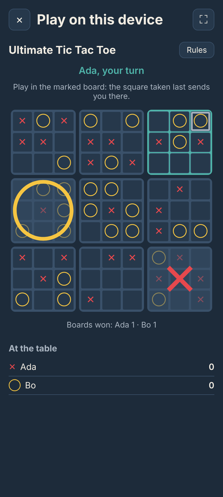</td>
  </tr>
  <tr>
    <td>Ultimate Tic Tac Toe</td>
  </tr>
</table>

On a laptop or a tablet, the game chooser, and games on one device, taking turns or on a split screen:

<table>
  <tr>
    <td colspan="2"></td>
  </tr>
  <tr>
    <td width="50%"></td>
    <td width="50%"></td>
  </tr>
  <tr>
    <td>Miau-Miau for four on a split screen</td>
    <td>Chinese Checkers for six</td>
  </tr>
</table>

The games in real time, between phones:

<table>
  <tr>
    <td width="37%"></td>
    <td width="37%"></td>
    <td width="26%"></td>
  </tr>
  <tr>
    <td>Light Racers: each phone steers its own rider</td>
    <td>Air Hockey, the whole rink on each phone</td>
    <td>Air Hockey, or each phone its own half: laid top edge to top edge, the puck slides from one screen to the other</td>
  </tr>
</table>

## Playing

Play in the browser at **[fionapreroll.github.io/vibe-mugames](https://fionapreroll.github.io/vibe-mugames/)**, or download the Android app, [`spielekiste.apk`](https://github.com/FionaPreroll/vibe-mugames/releases/latest/download/spielekiste.apk), and open it on the phone.

1. **Open a table** on the first phone, then **Add player**: it shows a QR code.
2. On the new player's phone, **Join a table** and scan that code. That phone then shows a code of its own, for the first phone to scan. Without a camera, both codes can be copied and pasted as text.
3. The host chooses a game. Up to eight phones sit at a table; whoever does not play watches and takes the next turn.

In the app, phones can also connect **by Bluetooth**, without any Wi-Fi. On a laptop or a tablet, **Play on this device** seats two to six players at one screen, taking turns or on a split screen.

[docs/PLAYING.md](docs/PLAYING.md) tells more: pairing tips, playing on one device, the screens, installing the website, updates, the connection details and the debug report.

## The games

| Tactics                                                       | Luck and bluff                            | Skill                                           |
| ------------------------------------------------------------- | ----------------------------------------- | ----------------------------------------------- |
| [Tic Tac Toe](docs/GAMES.md#tic-tac-toe), 2                   | [Ludo](docs/GAMES.md#ludo), 2–4           | [Light Racers](docs/GAMES.md#light-racers), 2–6 |
| [Ultimate Tic Tac Toe](docs/GAMES.md#ultimate-tic-tac-toe), 2 |                                           |                                                 |
| [Four in a Row](docs/GAMES.md#four-in-a-row), 2               | [Miau-Miau](docs/GAMES.md#miau-miau), 2–6 | [Air Hockey](docs/GAMES.md#air-hockey), 2       |
| [Nine Men's Morris](docs/GAMES.md#nine-mens-morris), 2        | [Sea Battle](docs/GAMES.md#sea-battle), 2 |                                                 |
| [Draughts](docs/GAMES.md#draughts), 2                         | [Mäxchen](docs/GAMES.md#mäxchen), 2–8     |                                                 |
| [Dots and Boxes](docs/GAMES.md#dots-and-boxes), 2             | [Werewolf](docs/GAMES.md#werewolf), 4–8   |                                                 |
| [Reversi](docs/GAMES.md#reversi), 2                           |                                           |                                                 |
| [Chinese Checkers](docs/GAMES.md#chinese-checkers), 2–6       |                                           |                                                 |

Each game's rules are in the Spielekiste, a step at a time with drawings, and in short in [docs/GAMES.md](docs/GAMES.md).

## Themes and stickers

Under _Settings_ → _Theme_, the Spielekiste takes on other colours, from wood and green felt to neon and a dim red for the dark. By default the Spielekiste follows the seasons, from Chinese New Year and Easter to Halloween and Christmas. [docs/THEMES.md](docs/THEMES.md) shows them all.

<table>
  <tr>
    <td width="16%">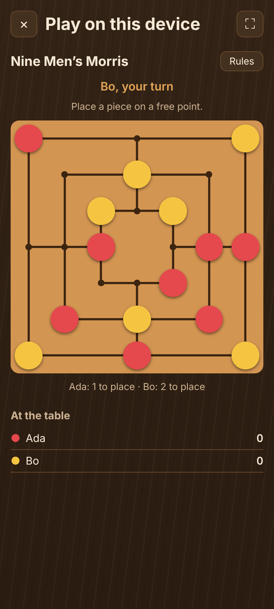</td>
    <td width="16%">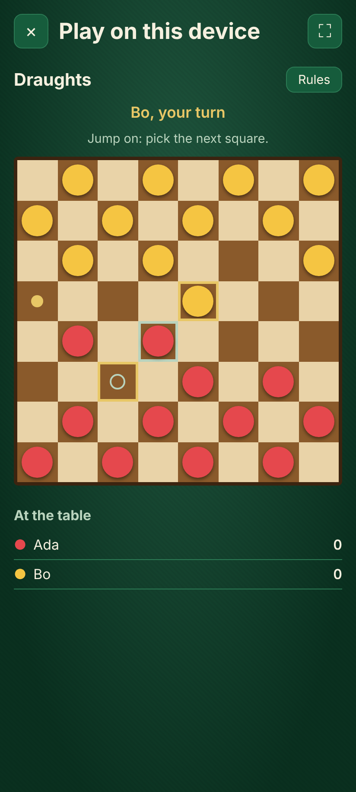</td>
    <td width="16%">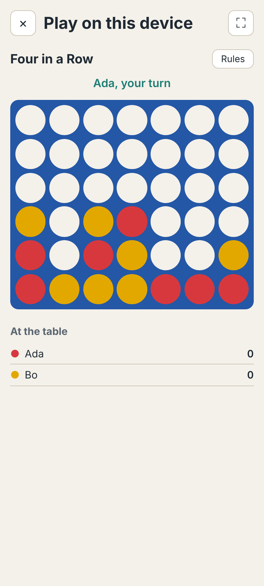</td>
    <td width="16%">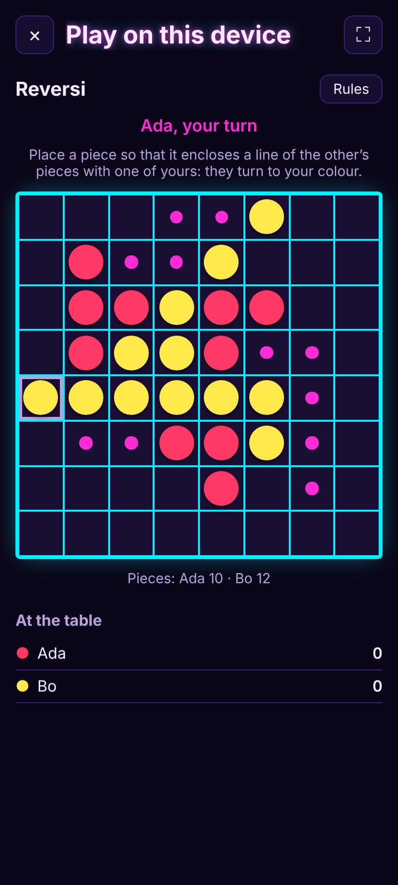</td>
    <td width="16%">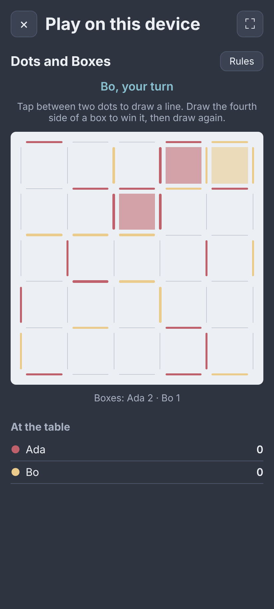</td>
    <td width="16%">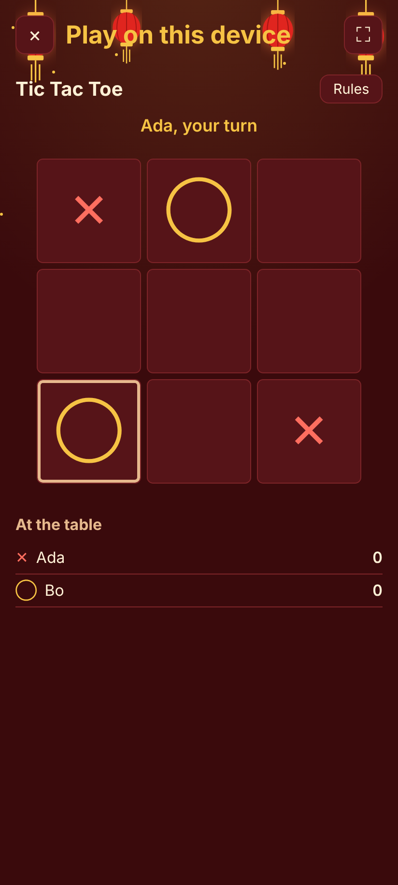</td>
  </tr>
  <tr>
    <td>Wood</td>
    <td>Green felt</td>
    <td>Light</td>
    <td>Neon</td>
    <td>Nord</td>
    <td>Chinese New Year</td>
  </tr>
</table>

On queer and trans days, weeks and months, a sticker on the box on the start screen says so, and a tap tells what it is for. [docs/STICKERS.md](docs/STICKERS.md) lists them.

<p>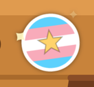     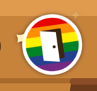 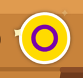  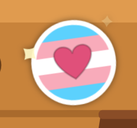 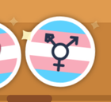 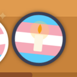</p>

## Also

- **English and German**, as the browser says, or as chosen on the start screen.
- **Privacy:** no accounts, no server, no advertising, no tracking. The policy is [`PRIVACY.md`](PRIVACY.md), in German [`PRIVACY.de.md`](PRIVACY.de.md).
- **Offline:** the website can be installed like an app, and starts without internet once opened.
- **Updates** are opt-in, in the settings, for the app and the website.
- **About the Spielekiste,** at the bottom of the start screen, shows the version, the changelog, the open-source licenses and the privacy policy.

## Development

```bash
pnpm install
pnpm dev         # the Spielekiste at localhost
pnpm check       # type check, Biome and unit tests
pnpm test:e2e    # browser tests in Chromium, over real WebRTC
```

- [docs/DEVELOPMENT.md](docs/DEVELOPMENT.md): tests and coverage, the libraries, screenshots, the Android app, adding a game, workflows, branches and the changelog.
- [docs/ARCHITECTURE.md](docs/ARCHITECTURE.md): how it works (the host decides everything, hidden cards, games in real time, one device, themes, updates, offline) and where everything lives.
- [docs/NETWORKING.md](docs/NETWORKING.md): the network from the bottom up, each game's messages, and air hockey's Kalman filter.

The connection comes from [`@fionapreroll/p2p`](https://github.com/FionaPreroll/vibe-p2pgame/tree/main/packages/p2p), Bluetooth from [`@fionapreroll/p2p-nearby`](https://github.com/FionaPreroll/vibe-p2pgame/tree/main/packages/p2p-nearby) and the app's updates from [`@fionapreroll/app-updates`](https://github.com/FionaPreroll/vibe-p2pgame/tree/main/packages/app-updates), developed with [Spark Hunt](https://github.com/FionaPreroll/vibe-p2pgame).

## Known limits

- **Tested end to end in Chromium only.** Real phones still need trying on a hotspot.
- **Bluetooth is unit-tested on fake phones, but not yet tried on real ones.**
- **The app's updates are unit-tested, but not yet tried on phones.** An app installed before builds were signed with the same key has to be uninstalled once.
- **Some Wi-Fi networks** isolate their clients, so the phones cannot see each other there; a phone's own hotspot does not.
- **A game on one device is not saved:** closing the page or the app ends it, scores and all.
- **Installing the website and starting it offline are tested in Chromium only:** not yet on real phones, nor the camera in the installed window. Safari on iPhones installs only through _Share_ → _Add to Home Screen_.
- **A host who closes the page ends the table:** players cannot sit down again until the host opens a new one. A player who drops out gets their place and score back by pairing again.
