# Networking in the Spielekiste

How phones of the Spielekiste talk to each other, from the code on a QR code up to the moves of each game, and how air hockey draws the puck smoothly through a network that delays every state by a different amount. Everything here is local: phones connect directly, over a Wi-Fi or a phone's hotspot, or over Bluetooth, with no server and no internet.

The lower layers are the library [`@fionapreroll/p2p`](https://github.com/FionaPreroll/vibe-p2pgame/tree/main/packages/p2p) and, for Bluetooth, [`@fionapreroll/p2p-nearby`](https://github.com/FionaPreroll/vibe-p2pgame/tree/main/packages/p2p-nearby); this document says what the Spielekiste relies on of them, and their READMEs say more.

- [The layers](#the-layers)
- [Transports](#transports): WebRTC paired by QR code, and Bluetooth
- [The room](#the-room): joining, rejoining, state, input and events
- [The Spielekiste's protocol](#the-spielekistes-protocol): the table and each game
- [Smoothing air hockey](#smoothing-air-hockey): the Kalman filter
- [The benchmark](#the-benchmark): plots, numbers and the tests that keep them

## The layers

```
 ┌────────────────────────────────────────────────────────────────────────────┐
 │ Rules        src/core: pure TypeScript, run by the host only               │
 ├────────────────────────────────────────────────────────────────────────────┤
 │ Spielekiste  src/net/protocol.ts, PROTOCOL 9                               │
 │              TableState (to each player its own), Input, Event 'move'      │
 ├────────────────────────────────────────────────────────────────────────────┤
 │ Room         @fionapreroll/p2p/room, ROOM_PROTOCOL 2                       │
 │              hello · welcome · mismatch · full · bye     (control)         │
 │              state · input · ping · pong                 (fast)            │
 │              event                                       (control)         │
 ├────────────────────────────────────────────────────────────────────────────┤
 │ Connection   two channels of JSON text, ≤ 16 384 characters a message      │
 │              control: reliable, in order · fast: may drop, no order        │
 ├──────────────────────────────────┬─────────────────────────────────────────┤
 │ WebRTC data channels             │ Nearby Connections (Bluetooth), through │
 │ paired by P1 codes (QR or text)  │ packetConnection                        │
 └──────────────────────────────────┴─────────────────────────────────────────┘
```

Every layer checks what it takes from the one below before use: the connection drops messages that are not text or are too long, the room drops messages whose type or fields do not fit, and the Spielekiste's parsers (`parseInput`, `parseEvent`, `parseState` in `src/net/protocol.ts`) check the game's part field by field, down to whether a Ludo position is possible. A phone of another version is told so (`mismatch`) and never misreads a message.

## Transports

### WebRTC, paired by QR code

A connection is a WebRTC peer connection with two data channels, negotiated up front with fixed ids, so that the offer already holds them (`link.ts`):

| Channel   | Id  | Delivery                                                 | Carries                                               |
| --------- | --- | -------------------------------------------------------- | ----------------------------------------------------- |
| `control` | 0   | reliable, in order                                       | joining, leaving, events (moves)                      |
| `fast`    | 1   | unordered, `maxRetransmits: 0`: dropped rather than late | the table many times a second, input, pings and pongs |

Without internet there is no STUN or TURN server: phones reach each other only through their own addresses on the shared network (`typ host` candidates). Gathering them takes milliseconds; a 3 s timeout is the safety net.

**Codes.** A browser's session description is 1–3 KB, too much for a QR code read from another phone's screen. Only five things in it differ between connections, so the code carries just those, about 150 characters (`signal.ts`):

```
P1~<o|a>~<setup>~<ufrag>~<pwd>~<fingerprint>~<address>,<port>!<address>,<port>…
```

`o` or `a` is offer or answer, `setup` the DTLS role (`x` actpass, `a` active, `p` passive), `ufrag` and `pwd` the ICE credentials, the fingerprint the SHA-256 of the DTLS certificate as unpadded base64url, and up to six candidates. `unpack` writes a minimal SDP around them. A code is anyone's to make, so every field is matched against the ICE grammar before it reaches the browser, and codes longer than 2 048 characters are not read at all. A change to the format needs a new prefix (`P2`), and the library's tests check that a code still fits a QR code that can be read from a screen.

**Pairing** takes two codes: the host shows an offer, a player scans it (or pastes it as text) and shows the answer, which the host scans. The DTLS fingerprint in each code ties the encrypted connection to the phone that showed it. The host waits for the player's answer up to ten minutes (`ANSWER_WAIT_MS`, `src/net/session.ts`), so that a code can be copied by hand.

### Bluetooth, through Nearby Connections

In the Android app, `@fionapreroll/p2p-nearby` offers Google's Nearby Connections, which connects over Bluetooth and may move up to Wi-Fi by itself for more speed. Whether it did shows in the connection details and the debug report: the other end's network (`bluetooth` or `wifi`) and how much Nearby says it carries (`low`, `medium` or `high bandwidth`), and the log notes each change. Phones advertise and discover the Spielekiste's own service id (`src/bluetooth.ts`), with the `P2P_STAR` strategy: one host, many players. A player asks to join; both phones show the same short code (Nearby's authentication digits), and the host lets the player in only after seeing that the codes match. At most four requests wait at once (`MAX_REQUESTS`); an accepted player who never connects is given up on after 30 s.

Each message travels as one Nearby byte payload: a byte for the channel (`c` control, `f` fast) and the text in UTF-8, 32 KB at most. The native side (`NearbyRules.java`) takes at most 120 messages a second from each phone, and keeps at most two `fast` messages in flight to each, six once Nearby moved the connection up to Wi-Fi, dropping newer ones while the link is busy, as WebRTC's unreliable channel would; the debug report counts what it dropped. `packetConnection` turns this into the same two-channel `Connection` as WebRTC, so the room knows nothing of Bluetooth, and one table can hold players over both. The library sends a Bluetooth player at most 15 states a second by default (`STATE_INTERVAL_MS`), as a radio may carry less; the Spielekiste sends every state instead (`BLUETOOTH_STATE_INTERVAL_MS`, `src/bluetooth.ts`), as air hockey's 30 states of about 500 bytes, 15 kB a second, are far below what Bluetooth carries, and each state skipped makes the game drawn later. When the radio is busy anyway, the fast lanes drop states instead of queueing them.

## The room

`HostRoom` runs on the host's phone, `GuestRoom` on each player's. Joining:

```
player                                              host
  │── hello {name, token, room: 2, version: 9} ──▶   │  within 15 s of the channels opening
  │◀── welcome {id, host, rejoined, room, version} ──│  or mismatch {room, version}, or full
  │◀── state … (fast, every tick) ───────────────────│
  │── input {data, ping} (fast, 30/s) ─────────────▶ │
  │── ping {sent} (fast, 1/s) ─────────────────────▶ │
  │◀── pong {sent} ──────────────────────────────────│
  │── event {data} (control) ──────────────────────▶ │
  │◀── event {data} (control) ───────────────────────│
  │◀── bye (control) ────────────────────────────────│  the host closed the table
```

- **Versions.** A player gets in only if both the room's version (`ROOM_PROTOCOL`, 2) and the game's (`PROTOCOL`, 9) match the host's; otherwise both phones say so.
- **Tokens.** Each browser keeps a random token (`src/storage.ts`). A player who drops out and comes back with the same token gets their id back, and with it their place and score.
- **Timeouts.** The host drops a connection that sends no `hello` within 15 s, and a player who sends nothing for 8 s; a player gives up on a host that does not answer `hello` within 10 s, or falls silent for 8 s. A ping unanswered for 3 s counts as lost.
- **State** goes out on `fast` every tick the game asks it to: newest wins, and a lost one is simply followed by the next. `stateFor` gives each player their own state, so a phone never receives what it may not see.
- **Input** goes out on `fast` 30 times a second, of which the host keeps the newest; it carries the player's last ping, so the host can show everyone's.
- **Events** go out on `control`: once each, in order. A player may send 30 a second (`MAX_EVENTS_PER_SECOND`); more are dropped.
- **Counts.** Both rooms count messages and characters each way, and pings sent, answered and lost.

## The Spielekiste's protocol

The host's phone keeps the table (`src/core/table.ts`) and runs the rules; players send moves and draw the table the host sends. `src/net/protocol.ts` defines the messages, and `PROTOCOL` goes up whenever any of them changes.

### Rates

The host ticks 30 times a second (`TICK_MS`). It sends the table every tick while a game in real time is on, and every third tick otherwise: 10 times a second, plenty for turns and quick to show who joined. Bluetooth players get the same.

### The table: `TableState`

| Field                  | What it holds                                                                                                                         |
| ---------------------- | ------------------------------------------------------------------------------------------------------------------------------------- |
| `players`              | id, name and whether away, for up to 8                                                                                                |
| `game`, `seats`        | the game on the table, or none, and the players' ids in seat order, within the game's seat range                                      |
| `round`                | the number of the game, counting rematches: a move or input for another round is ignored                                              |
| `moveNo`, `last`       | how many moves were made, and the last one, so phones can show it (never in Werwolf: it would tell a vote)                            |
| `outcome`, `scores`    | winner and winning line, or draw; points per player id                                                                                |
| one field for the game | `position`, `ludo`, `cards`, `sea`, `dice`, `village`, `words`, `race`, `rink`, `snakes`, `reaction` or `echo`: the others are `null` |

Every field is checked: sizes fit the game and the number of seats, pieces belong to seats that play, cards come from one deck without repeats, a disc is on or near the rink.

### Moves: `Event`

```ts
{ type: 'move', game, moveNo, move: number[] }
```

A move names the game and the move number it is meant to be. The host takes it only from the player whose turn it is, only if it is that move number, and only if the rules allow it, so a move sent twice, or one meant for a position that has passed, counts at most once. Games where everyone chooses at once (Sea Battle's fleets, Werwolf's choices, the answers of Stadt, Land, Fluss) take a choice whatever its move number, as long as it belongs to the phase now on. Words travel as their characters' numbers, one for each, which the host cleans and cuts.

### Each game

| Game                                                                             | Table field                                                               | Everyone sees                                                        | A move (`number[]`)                                                                                            |
| -------------------------------------------------------------------------------- | ------------------------------------------------------------------------- | -------------------------------------------------------------------- | -------------------------------------------------------------------------------------------------------------- |
| Tic Tac Toe, Vier in einer Reihe, Mühle, Dame, Käsekästchen, Reversi, Sternhalma | `position`: board, turn, pieces in hand, phase, quiet moves               | everything                                                           | a path of cells: one cell or column, from and to, or every square of a jump                                    |
| Ludo                                                                             | `ludo`: every piece's step, die, turn, last move                          | everything; the host rolls                                           | `4` rolls, `0`–`3` moves that piece                                                                            |
| Miau-Miau                                                                        | `cards`: `MiauView`                                                       | their own hand, the others' counts, the top card                     | a card `0`–`51` (with a wished suit for a jack), `52` draws, `53` passes                                       |
| Sea Battle                                                                       | `sea`: `SeaView`                                                          | their own fleet, every shot, the hits, the ships sunk                | a shot `0`–`99`, or a fleet: each ship's first square, plus 100 if it lies down                                |
| Mäxchen                                                                          | `dice`: `MaexView`                                                        | lives, claims; the dice only the roller, until a doubt               | `1` rolls, `2` doubts, `3` gives up, a throw such as `53` claims it                                            |
| Werwolf                                                                          | `village`: `WolfView`                                                     | their own role, fellow wolves', the seer's findings                  | the seat chosen                                                                                                |
| Stadt, Land, Fluss                                                               | `words`: `WordsView`                                                      | their own answers; everyone's once they are checked                  | `[1, category, …characters]` writes, `2` stops, `[3, seat, category]` objects, `4` ready                       |
| Montagsmaler                                                                     | `sketch`: `SketchView`                                                    | the drawing, the guesses; the word only the one drawing, until shown | `[1, …points]` draws, `2` undoes, `3` clears, `[4, i]` chooses, `[5, …characters]` guesses, `[6, seat]` got it |
| Lichtrenner                                                                      | `race`: riders' walls as the cells where they turn                        | everything                                                           | no moves; input `[round, heading]`                                                                             |
| Air hockey                                                                       | `rink`: puck, mallets, goals, pause, `clock`                              | everything                                                           | no moves; input `[round, x, y]`, where the mallet should go in the player's own half                           |
| Snakes                                                                           | `snakes`: every snake's cells, head first, its heading, the apples        | everything                                                           | no moves; input `[round, heading]`, as in Lichtrenner                                                          |
| Reaction                                                                         | `reaction`: the phase, the signal's number, each seat's answer and points | everything but how long the wait still is                            | no moves; input `[round, signal, ms]`, the time the phone measured, or `-1` too early                          |
| Colour Echo                                                                      | `echo`: `EchoView`                                                        | the row only while it lights up, their own taps, everyone's progress | no moves; input `[round, length, count, packed…]`, every tap of this row, 16 to a number                       |

**Games in real time** have no turns. A player's phone sends what they want now as the room's input, 30 times a second, of which only the newest counts, after the `round` it is meant for, so last game's input never steers the next. The host runs the game by the time that passed: Lichtrenner moves a cell a step on a grid; air hockey moves its puck in steps of 1/240 s, so nothing slides through a mallet, and each state carries the host's game time, `clock`, to the millisecond. Snakes steps like Lichtrenner, and places new apples with the host's randomness. In Reaction, each phone measures its player's time itself, from the frame that first showed the signal, and sends it with the signal's number: the host compares times, so the network's delay counts for nobody, and never sends when the signal will come. In Colour Echo, a phone sends every tap of the row each time, so that a lost input loses nothing; the host takes only the taps beyond those it has.

## Smoothing air hockey

Air hockey is the only game where how a state arrives shows: the puck crosses the rink in a second or two, so a state that comes 30 ms late puts it some 3 % of the rink's width off. Each state is exact; only when it arrives varies, by the one-way delay and its jitter, a few milliseconds on a quiet Wi-Fi, tens on a busy one or over Bluetooth, now and then a spike of a hundred or more.

**Without smoothing**, a phone draws the newest state from the moment it arrived, gliding the puck on in a straight line (bouncing off the boards) for up to 0.15 s. A state that arrives late is drawn as if it were new, so the puck jumps back; one that arrives early makes it jump on. The drawn host time follows the arrival of each state, jitter and all (the blue lines in the plots below).

**With _Smooth out the network_** (`hockeySmoothing` in the settings, on unless switched off), the phone draws by the host's clock as a Kalman filter reads it. It was off at first, until a game over Bluetooth on real phones felt laggy; the setting was renamed with it, so that every phone, which kept the old one as off when it saved any setting, starts smoothed once.

### What the filter estimates

The state is one number: the offset from this phone's clock to the host's game clock, as states reach this phone,

```math
\theta = t_\text{host} - t_\text{local}
```

which holds the two clocks' difference and the mean one-way delay together. They cannot be told apart without a round trip, and need not be: drawing at `local + θ` shows the host's game as it was a mean delay ago, which is the best a phone can do without guessing the players' next moves.

Each state is a measurement: stamped `h` by the host (`HockeyView.clock`), arriving at `a` on this phone's clock (`performance.now()`),

```math
z_k = h_k - a_k = \theta_k - \varepsilon_k ,
```

where `ε` is the delay's deviation from its mean: the jitter.

### The model

A random walk, as a connection's delay wanders slowly:

```math
\theta_k = \theta_{k-1} + w_k, \qquad w_k \sim \mathcal N(0,\; q\,\Delta t_k)
```

with `Δt` the local time since the last measurement and `q` the process noise (`drift`, 10⁻⁴ s²/s by default: the offset may wander by about 10 ms in a second). The measurement noise `R` is the jitter's variance. Each state then makes the usual scalar Kalman steps (`HostClock.observe`, `src/net/clock.ts`):

```math
\begin{aligned}
P^- &= P + q\,\Delta t && \text{predict}\\
\nu &= z - \hat\theta && \text{innovation}\\
R &\leftarrow \operatorname{clamp}\big((1-\lambda) R + \lambda\,\nu^2,\; 10^{-6},\; 0.05\big) && \text{learn the jitter}\\
K &= P^- / (P^- + R) && \text{gain}\\
\hat\theta &\leftarrow \hat\theta + K\,\nu, \qquad P = (1-K)\,P^- && \text{update}
\end{aligned}
```

`now(local) = local + θ̂` is then a host time that runs at exactly this phone's pace, instead of jumping with every state.

### Considerations

- **Only time is filtered, not positions.** The host's positions are exact; filtering them would only delay them. The puck and the other mallet are drawn where the newest state puts them, glided on from its `clock` to the filtered time, just as without smoothing, only to a steadier time.
- **One number, not two.** Phone clocks run apart by tens of parts per million, well under a millisecond in a minute, against jitter of tens of milliseconds. A second state for the skew would cost stability for nothing the random walk does not already absorb.
- **The jitter is learned, not assumed.** `R` is an exponential average of the squared innovation (`λ` = `learn`, 0.05: about the last 20 states), within 10⁻⁶ s² (1 ms) and 0.05 s² (220 ms). It starts at 10⁻³ s² (32 ms). A quiet network thus gets a quick filter, a busy one a steady one. In the steady state the gain is about `√(q Δt / R)`: on busy Wi-Fi, where it learns `R` ≈ (17 ms)², about 0.1, so a state moves the offset by a tenth of its surprise, and a jitter of tens of milliseconds becomes a few.
- **The drawn time stays near the newest state.** `RinkSmoother.time` keeps the filtered time between 50 ms behind and 150 ms ahead of the newest state's `clock`, the same 150 ms that unsmoothed drawing glides at most; the filter never draws further from the host's word than drawing without it does.
- **Corrections fade in.** When a new state changes where the puck was meant to be at the time drawn, as when it shows a hit the phone could not know of, the difference fades out over about 80 ms (`Eased`) instead of jumping; a jump of more than 0.3 rink widths, such as the puck put back after a goal, is drawn at once.
- **The player's own mallet does not wait,** with or without smoothing. A mallet steered on this phone moves to the finger at once by the host's own rule (`OwnMallet`: `slide`, at most the host's speed and within the player's half), instead of a round trip later. Drawn from the host's state, it would lag by the whole loop: the finger's place waits for the next input (up to 33 ms), crosses to the host, waits for its tick (up to 33 ms) and for the next state to this player (up to 33 ms; up to 67 ms over Bluetooth before it got every state), and crosses back; over Bluetooth, with a round trip of about 80 ms, that is 100 to 250 ms. The host slides its mallet towards the same places a moment later, so both come to rest at the same point; only the puck's bounces off it are the host's, and come that moment later.
- **Starting anew.** The filter resets at its first state, at a new game (`round`), when the host's clock goes back by more than 0.5 s, and when a measurement is more than 0.5 s off the estimate, such as a page that was in the background. A state older than the newest, overtaken on the fast channel, is ignored.

### Limits

- **Delay is not Gaussian.** It has a floor and a long tail: spikes pull the estimate a little (a 120 ms spike on busy Wi-Fi moves it by some 10 ms, the small bumps in the plots). A filter that gated or down-weighted large innovations, or one that followed the least delay rather than the mean, could draw sooner and steadier.
- **A lasting change of delay is first taken for jitter.** The learned `R` grows, which slows the gain while the offset is off: the default follows a step of 100 ms within about 2.4 s. A larger `q` follows sooner but passes on more jitter; see the delay step below.
- **The puck after a hit.** The phone learns of a hit only from the next state, so the eased correction lags the true path for a few frames. On a quiet network, where drawing by arrival is already close, this costs a little: see the quiet Wi-Fi numbers.

## The benchmark

`tools/smoothing.ts` measures the drawing without smoothing and with the filter at three settings, on four made-up networks, through the same code as the rink on the screen (`src/net/smooth.ts`):

- **The host** runs a real game of air hockey (`src/core/airhockey.ts`) for 24 s between two simple players, who strike through the puck while it is in their half, off to one side as chance has it, and wait in front of their goal otherwise. It records the puck every 1/240 s, and sends its state as phones get it.
- **The network** delays each state by a fixed delay, plus jitter spread evenly from 0 up to a bound, plus now and then a spike, and may reorder them. The phone's clock is 1 000 s off the host's, as the filter must not care.
- **The phone** draws 60 frames a second: the host time it draws, and where it draws the puck.
- **Everything comes from fixed seeds**, so every run, on every computer, gives the same numbers and the same plots.

| Network         | Delay | Jitter (up to) | Spikes         | States a second | Else                           |
| --------------- | ----- | -------------- | -------------- | --------------- | ------------------------------ |
| Quiet Wi-Fi     | 8 ms  | 6 ms           | 1 % of +30 ms  | 30              |                                |
| Busy Wi-Fi      | 20 ms | 60 ms          | 5 % of +120 ms | 30              |                                |
| Bluetooth       | 20 ms | 45 ms          | 4 % of +60 ms  | 30              | as a Fairphone 4 measured it   |
| Bluetooth, 15/s | 20 ms | 45 ms          | 4 % of +60 ms  | 15              | as the library's default sends |
| Delay step      | 20 ms | 30 ms          | 2 % of +80 ms  | 30              | 100 ms more from second 12 on  |

| Method                     | `HostClock` options                        |
| -------------------------- | ------------------------------------------ |
| Unfiltered                 | none: drawn from each state's arrival      |
| Kalman (default, q = 10⁻⁴) | `{}`: what phones use                      |
| Kalman, q = 10⁻³           | `{ drift: 1e-3 }`: follows faster, rougher |
| Kalman, q = 10⁻⁵           | `{ drift: 1e-5 }`: steadier, slower        |

### What is measured

The first 4 s are left out, while the filter learns.

- **Clock roughness** (ms, RMS): how far the drawn host time moves from one frame to the next beyond the frame's own 16.7 ms. A perfectly even drawing scores 0; every jump of the puck back or forth shows here.
- **Lag** (ms): how far the drawn host time is behind the host's own, on average, and its spread around that average. With the delay step, the average is taken before the step and from two seconds after it, each on its own.
- **Puck error** (% of the rink's width, RMS and 95th percentile): how far the drawn puck is from where the host had it at the method's own average lag, which is what a perfectly even drawing at that lag would show. Frames within 0.3 s of a goal or a face-off are left out, as there every drawing jumps.
- **Settles** (ms): after the delay step, how long until the lag, averaged over half a second, stays within 10 ms of where it ends up. _Never_ if it still strays in the last three seconds: too slow to get there, like q = 10⁻⁵, or knocked off by every spike, like drawing by arrival.

### Results

<!-- smoothing:results -->

| Network         | Method                     | Clock roughness (ms) | Lag (ms) | Lag spread (ms) | Puck error, RMS (%) | Puck error, 95th (%) | Settles (ms) |
| --------------- | -------------------------- | -------------------: | -------: | --------------: | ------------------: | -------------------: | -----------: |
| Quiet Wi-Fi     | Unfiltered                 |                 1.76 |    11.05 |            1.75 |                0.23 |                 0.45 |            – |
| Quiet Wi-Fi     | Kalman (default, q = 10⁻⁴) |                 0.74 |    11.24 |            1.10 |                0.35 |                 0.51 |            – |
| Quiet Wi-Fi     | Kalman, q = 10⁻³           |                 1.50 |    11.27 |            1.77 |                0.37 |                 0.65 |            – |
| Quiet Wi-Fi     | Kalman, q = 10⁻⁵           |                 0.29 |    11.20 |            0.63 |                0.34 |                 0.46 |            – |
| Busy Wi-Fi      | Unfiltered                 |                30.35 |    54.03 |           30.77 |                2.70 |                 4.49 |            – |
| Busy Wi-Fi      | Kalman (default, q = 10⁻⁴) |                 1.16 |    48.05 |            4.34 |                0.60 |                 0.98 |            – |
| Busy Wi-Fi      | Kalman, q = 10⁻³           |                 3.24 |    47.58 |            7.52 |                0.80 |                 1.51 |            – |
| Busy Wi-Fi      | Kalman, q = 10⁻⁵           |                 0.38 |    48.13 |            2.25 |                0.54 |                 0.67 |            – |
| Bluetooth       | Unfiltered                 |                15.55 |    42.15 |           16.44 |                1.50 |                 2.98 |            – |
| Bluetooth       | Kalman (default, q = 10⁻⁴) |                 1.10 |    42.15 |            3.36 |                0.53 |                 0.81 |            – |
| Bluetooth       | Kalman, q = 10⁻³           |                 3.00 |    41.93 |            6.02 |                0.65 |                 1.33 |            – |
| Bluetooth       | Kalman, q = 10⁻⁵           |                 0.36 |    42.22 |            1.67 |                0.48 |                 0.51 |            – |
| Bluetooth, 15/s | Unfiltered                 |                12.25 |    42.00 |           15.26 |                1.29 |                 3.11 |            – |
| Bluetooth, 15/s | Kalman (default, q = 10⁻⁴) |                 1.11 |    44.47 |            3.94 |                0.88 |                 1.64 |            – |
| Bluetooth, 15/s | Kalman, q = 10⁻³           |                 3.06 |    44.47 |            6.96 |                0.97 |                 2.00 |            – |
| Bluetooth, 15/s | Kalman, q = 10⁻⁵           |                 0.37 |    44.24 |            2.10 |                0.85 |                 1.43 |            – |
| Delay step      | Unfiltered                 |                14.05 |    84.60 |           13.10 |                1.02 |                 2.01 |        never |
| Delay step      | Kalman (default, q = 10⁻⁴) |                 1.07 |    84.70 |            3.66 |                0.44 |                 0.81 |         2400 |
| Delay step      | Kalman, q = 10⁻³           |                 2.94 |    85.28 |            4.52 |                0.52 |                 1.12 |          550 |
| Delay step      | Kalman, q = 10⁻⁵           |                 0.35 |    70.10 |           22.46 |                0.61 |                 1.38 |        never |

<!-- /smoothing:results -->

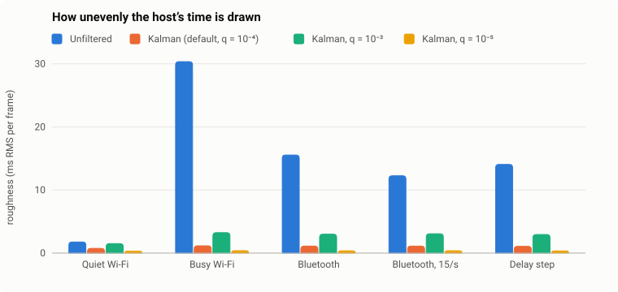

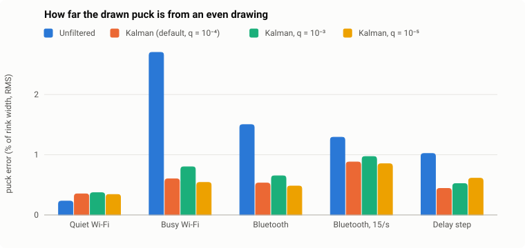

**Reading them.** Where the network shakes, the filter draws the host's time 12 to 26 times more evenly, and the puck one and a half to four and a half times closer to an even drawing, at about the same lag. Of the settings, q = 10⁻⁵ is steadiest but takes far too long to follow a lasting change of delay, and q = 10⁻³ follows within half a second but passes on nearly three times as much jitter; the default sits between. On a quiet Wi-Fi there is little to smooth: the clock is still steadier, but the puck is a little further off, by a fraction of a millimetre on a phone's screen, as corrections after a hit are faded in rather than drawn at once.

**Bluetooth, 15 or 30 states a second.** The Bluetooth network is calibrated from a debug report of a game of air hockey between two phones over Nearby: round trips of 82 ms in the middle, 95 % under 137 ms, from 43 to 190 ms. With the filter, every state instead of every other draws the puck about 40 % closer to an even drawing, as it glides on for half as long between states, and a hit shows a state sooner; the drawn time is about as late, as the puck glides on in between either way.

### The host's time, drawn

How far behind the host each method draws, frame by frame. The spikes of the blue line are the puck jumping back and on.

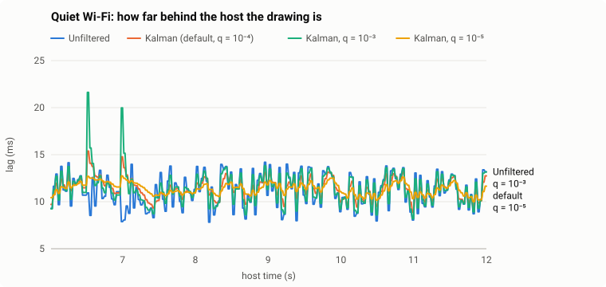

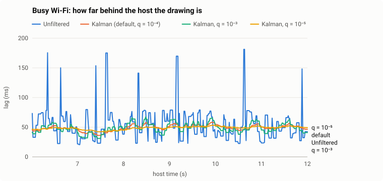

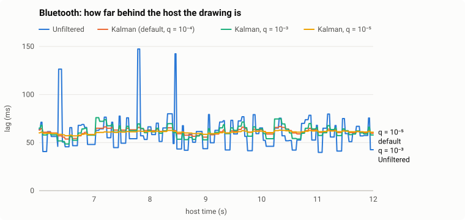

At second 12 the delay grows by 100 ms, as when a phone walks away from the hotspot:

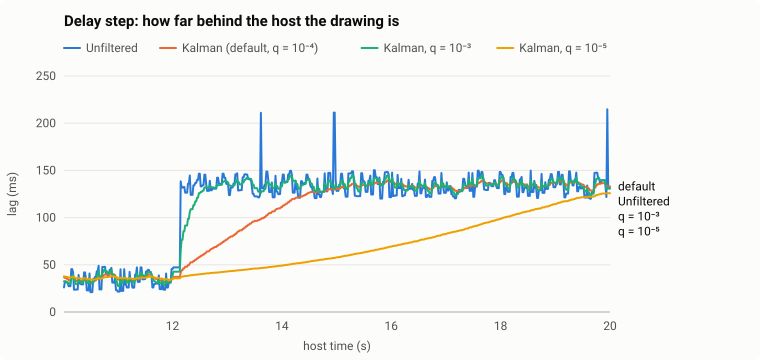

### The puck, drawn

How far along the rink each method draws the puck ahead of (+) or behind (−) an even drawing, without smoothing and with the default filter; frames near goals are left out.

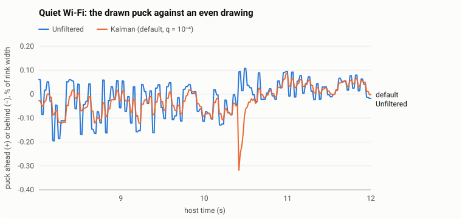

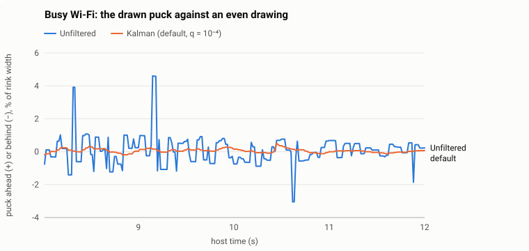

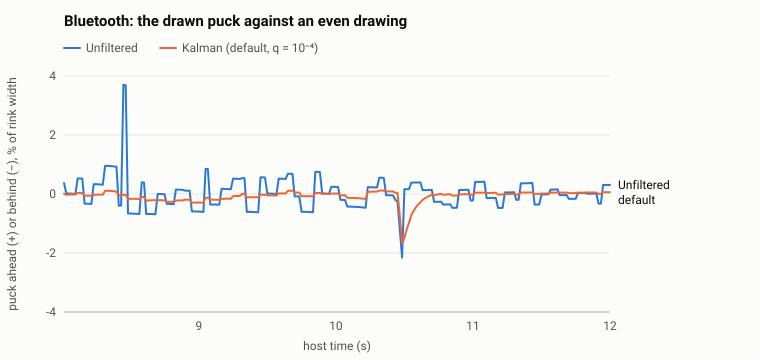

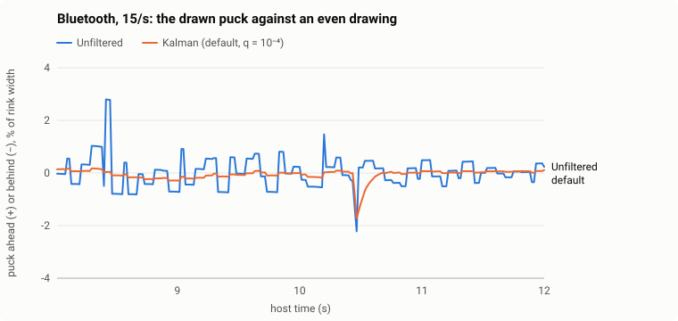

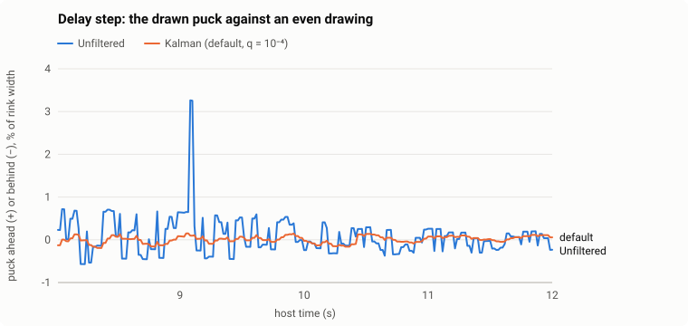

And the puck itself, over half a second of busy Wi-Fi:

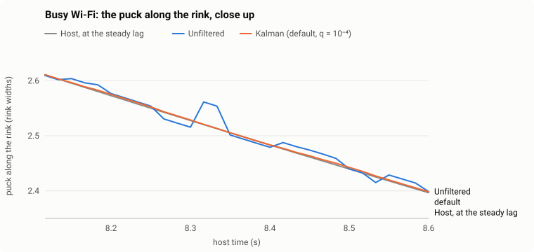

### Keeping it so

`tools/smoothing.test.ts`, part of `pnpm test`, runs the benchmark and fails if

- the filter no longer draws the host's time at least five times more evenly than arrival on busy Wi-Fi, Bluetooth and the delay step, or no more evenly on quiet Wi-Fi, or its lag spreads more than 8 ms on busy Wi-Fi;
- it no longer draws the puck at least twice as close on busy Wi-Fi, and a fifth closer on Bluetooth and the delay step, or the puck error grows past 0.6 % (quiet), 1 % (busy, step) or 1.2 % (Bluetooth);
- with every state over Bluetooth, it no longer draws the puck a fifth closer than with every other;
- it lags more than 15 ms behind drawing by arrival;
- it no longer follows the delay step within 3 s, or the settings no longer sit in order (q = 10⁻³ sooner, q = 10⁻⁵ later);
- the numbers, the table above or the plots in `docs/networking/` are not what the code gives now.

After a change to the filter, the drawing, the game's physics or the benchmark, write them anew and review the diff, numbers and plots alike:

```bash
pnpm bench:smoothing
```
