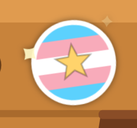
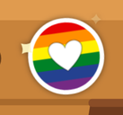
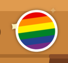
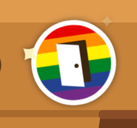
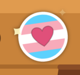
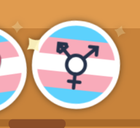
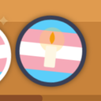

# Stickers

On queer and trans days, weeks and months, a sticker on the box on the start screen says so. Each is round, in its flag's stripes, with a mark in the middle for those that share a flag. They sparkle a little, except the Transgender Day of Remembrance's, a day of mourning, whose candle glows quietly. When several hold at once, each has its own sticker, side by side on the box's front.

Hovering over a sticker shows what it is for (its SVG `<title>`); a tap or Enter shows the same in a message that stays seven seconds; screen readers hear it with the picture's label. The texts are in `src/i18n.ts` (`sticker…`), in English and German.

| Sticker                      | When                                                         | Flag and mark                    | id           |
| ---------------------------- | ------------------------------------------------------------ | -------------------------------- | ------------ |
|        | Trans Day of Visibility, 31 March                            | trans flag, a star               | `tdov`       |
|    | IDAHOBIT, 17 May                                             | rainbow, a heart                 | `idahobit`   |
|       | Pride Month, all of June                                     | rainbow                          | `pride`      |
|   | International Non-Binary People's Day, 14 July               | non-binary flag                  | `nonbinary`  |
|          | Bi Visibility Day, 23 September                              | bi flag                          | `bi`         |
|   | Coming Out Day, 11 October                                   | rainbow, an open door            | `comingout`  |
|    | Intersex Awareness Day, 26 October                           | intersex flag                    | `intersex`   |
|         | Ace Week, the last full week of October (Sunday to Saturday) | asexual flag                     | `ace`        |
|  | Trans Awareness Month, all of November                       | trans flag, a heart              | `transMonth` |
|   | Trans Awareness Week, 13 to 19 November                      | trans flag, the trans symbol     | `transWeek`  |
|        | Transgender Day of Remembrance, 20 November                  | trans flag, a candle; no sparkle | `tdor`       |

Days that meet: Intersex Awareness Day can fall in Ace Week (two stickers), and November always has the month's sticker beside the week's or the Day of Remembrance's. The box has room for four; a test checks that no day of the year needs more.

_The pictures were taken by hand on 4 November 2026._

## How it works

- `stickersOn(date)` in `src/awareness.ts` names the stickers for a day, in local time, as pure TypeScript with tests beside it (`src/awareness.test.ts`); `aceWeekStart` finds Ace Week.
- `hero()` in `src/ui/hero.ts` puts them on the box's front (`STICKER_PLACES`, right of the grip first), each drawn from `LOOKS`: its stripes with their widths, its mark, and whether it is calm.
- Their motion is in `src/style.css` (`.hero .sticker`): a soft shine and three sparkles, or the candle's glow; all hold still under `prefers-reduced-motion`. The themes leave them as they are, except _Night mode, red_, which turns the whole picture red.

## Adding a sticker

1. Add its id to `STICKERS` and its dates to `stickersOn` in `src/awareness.ts`, with tests.
2. Give it a text in `src/i18n.ts`, English and German (`STICKER_TEXTS` in `src/ui/hero.ts`), saying what the day is and when.
3. Give it a look in `LOOKS`: its flag's stripes, and a mark if another sticker shares the flag.
4. Add it to this page and the changelog.
