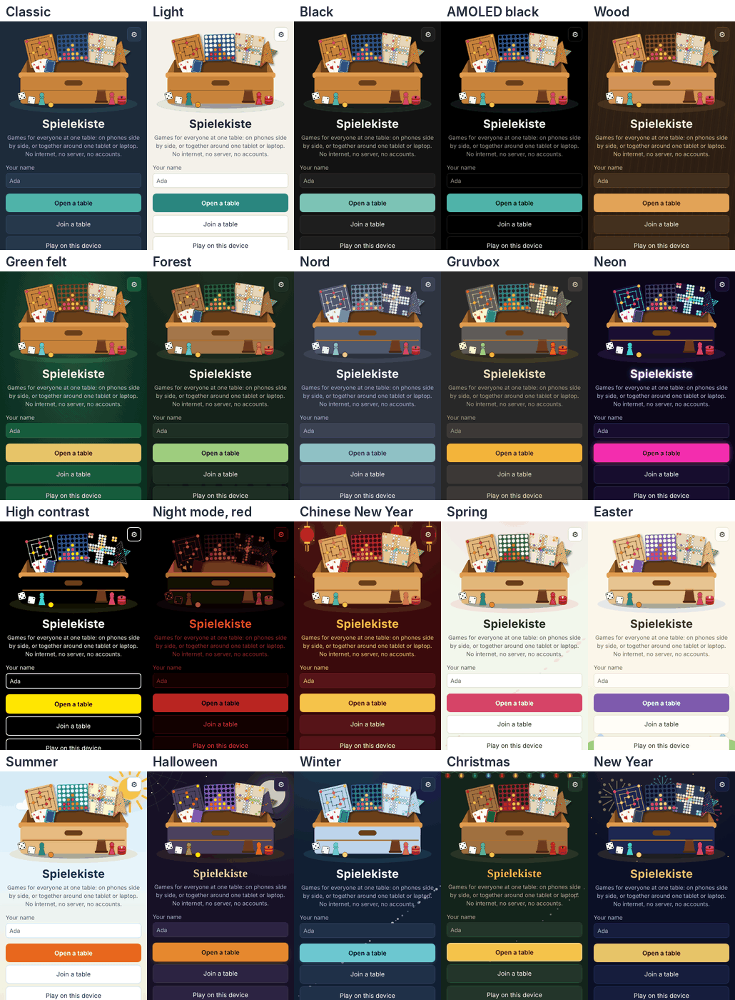

# Themes

The Spielekiste's colour themes, chosen under _Settings_ → _Theme_. Each device keeps its own (`settings().theme`, checked by `parseSettings`). A device that never chose one follows the seasons.

_The start screen in each theme. The picture was taken by hand on 4 November 2026; it is not refreshed by `pnpm screenshots`._

## With the seasons

The first choice, and the default: the theme follows the calendar, in local time (`seasonalTheme` in `src/theme.ts`). The feasts come first; between them, the seasons.

| When                                                             | Theme            |
| ---------------------------------------------------------------- | ---------------- |
| Chinese New Year: its eve to the Lantern Festival, 14 days after | Chinese New Year |
| Palm Sunday to Easter Monday                                     | Easter           |
| 1 October to 1 November                                          | Halloween        |
| 1 to 27 December                                                 | Christmas        |
| 28 December to 6 January                                         | New Year         |
| otherwise November to February                                   | Winter           |
| otherwise March to May                                           | Spring           |
| June to August                                                   | Summer           |
| September                                                        | Classic          |

Chinese New Year follows the moon, so its first day is looked up in `CHINESE_NEW_YEAR`, which runs to 2040; a later year has none until the table grows. Easter is worked out (`easterSunday`, the Gregorian computus).

## Every theme

| Theme (id)       | English / German                        | What it looks like                                                       | Behind the screens                    |
| ---------------- | --------------------------------------- | ------------------------------------------------------------------------ | ------------------------------------- |
| `classic`        | Classic / Klassisch                     | The Spielekiste's own dark blue, with teal                               |                                       |
| `light`          | Light / Hell                            | Paper white, for daylight                                                |                                       |
| `black`          | Black / Schwarz                         | A quiet, neutral dark grey                                               |                                       |
| `amoled`         | AMOLED black / AMOLED-Schwarz           | Pure black, which turns an OLED screen's pixels off                      |                                       |
| `wood`           | Wood / Holz                             | A walnut table, amber buttons                                            | wood grain                            |
| `felt`           | Green felt / Grüner Filz                | A card table's green felt, with brass                                    | the felt's weave                      |
| `forest`         | Forest / Wald                           | Deep woods, moss and bark                                                | firs along the bottom                 |
| `nord`           | Nord                                    | After the Nord colour scheme: polar night, frost and aurora              |                                       |
| `gruvbox`        | Gruvbox                                 | After the Gruvbox colour scheme: warm retro colours                      |                                       |
| `neon`           | Neon                                    | A dark arcade, with glowing pink and cyan lines                          |                                       |
| `contrast`       | High contrast / Hoher Kontrast          | Black and white, yellow for what can be done, thicker borders            |                                       |
| `nightred`       | Night mode, red / Nachtmodus, rot       | Dim reds on black only, for eyes used to the dark; pictures turn red too |                                       |
| `chinesenewyear` | Chinese New Year / Chinesisches Neujahr | Lacquer red and gold                                                     | red lanterns swaying                  |
| `spring`         | Spring / Frühling                       | Light: a fresh morning, young green and cherry-blossom pink              | blossom petals drifting down          |
| `easter`         | Easter / Ostern                         | Light: pastels and lilac                                                 | a meadow with painted eggs            |
| `summer`         | Summer / Sommer                         | Light: a blue sky and the sun's orange                                   | the sun, its rays turning, and clouds |
| `halloween`      | Halloween                               | The puzzles' "Mondnacht": a violet night with embers                     | the moon, bats, stars and a cobweb    |
| `winter`         | Winter                                  | The puzzles' polar night: ice cyan under northern lights                 | falling snow                          |
| `christmas`      | Christmas / Weihnachten                 | The puzzles' fir green night, with gold                                  | fairy lights and a little snow        |
| `newyear`        | New Year / Silvester                    | Midnight blue with champagne gold                                        | fireworks and sparkles                |

Halloween, Winter and Christmas take their colours from the night looks of the [puzzles](https://github.com/FionaPreroll/vibe-puzzles) (`src/routes/halloween.css`, `winter.css`, `christmas.css` there). Decorations hold still for players whose device asks for less motion.

## How it works

- **Tokens.** Every colour in `src/style.css` is a token on `:root, [data-theme]`, with the classic values: the page (`--bg`, `--panel`, `--line`, `--text`, `--muted`, `--accent`, `--on-accent`), the seats (`--seat-0` to `--seat-5`), the boards (`--wood`, `--board-line`, `--board-light`, `--board-dark`, `--board-edge`, `--ludo`, `--frame`, `--felt`, `--felt-deep`, `--dots-paper`, `--dots-line`, `--dot`), cards and dice (`--paper`, `--paper-edge`, `--ink`, `--card-red`, `--card-blue`, `--card-blue-deep`, `--card-edge`, `--cup`), Sea Battle (`--sea`, `--sea-deep`, `--sea-target`, `--water`, `--water-text`, `--ship`, `--sunk`), the games in real time (`--field`, `--field-line`, `--rider`, `--rink`, `--rink-line`, `--puck`), notes and the connection (`--warning-text`, `--good`, `--fair`, `--poor`), and a picture behind the page (`--backdrop`). Nothing else in the style sheet names a colour of its own.
- **Themes.** `src/themes.css` gives each other theme its values, on `[data-theme="…"]`, and what changes more than colours (glows, fonts, borders) on `:root[data-theme="…"]`. A theme sets only the tokens it changes; the rest stay classic.
- **Applying.** `applyTheme` (`src/ui/theme.ts`) sets `<html data-theme>` (none for classic), the browser bar's colour, `color-scheme` (light for `LIGHT_THEMES`), and the decorations in `.decor`, a layer behind every screen. `src/main.ts` applies the saved choice at the start; the settings apply a new one at once.
- **Drawings and canvases.** The rules' drawings use the tokens as `var(--…)` (`INK` in `src/ui/rules/draw.ts`). Canvases cannot, so `themeColour` and `colour` (`src/ui/canvas.ts`) read the tokens and keep them until the theme changes.
- **Swatches.** Each choice in the settings is a small picture with its own `data-theme`, so it shows its own theme whatever the page wears.

## Adding a theme

1. Add its id to `THEMES` in `src/theme.ts` (and to `SEASONAL_THEMES` and `seasonalTheme` if the calendar should choose it, to `LIGHT_THEMES` if it is light).
2. Give it a name in `src/i18n.ts`, in English and German, and in `NAMES` in `src/ui/theme.ts`.
3. Give it its tokens in `src/themes.css`. Check every board with it: Mühle and Sternhalma lie on `--wood` with `--board-line`, Ludo's squares are `--paper` on `--ludo`, and pieces in seat colours must stand out on them.
4. Decorations, if any, go into `DECORATIONS` in `src/ui/theme.ts`, with their CSS in `src/themes.css`, still under `prefers-reduced-motion`.
5. Add it to this page and the changelog.

A new colour on a board is a new token in `src/style.css`, with a value in each theme that needs another.
